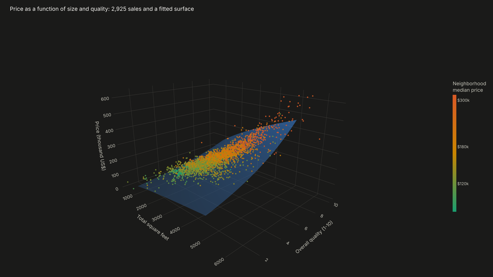
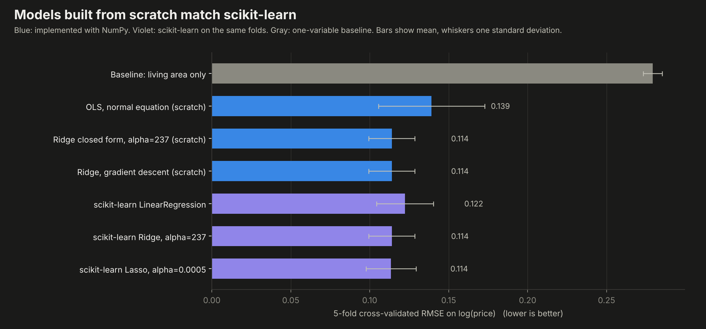
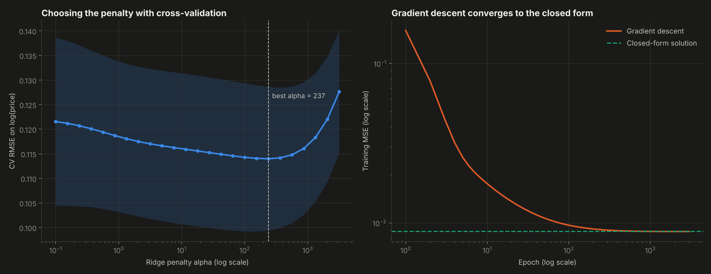
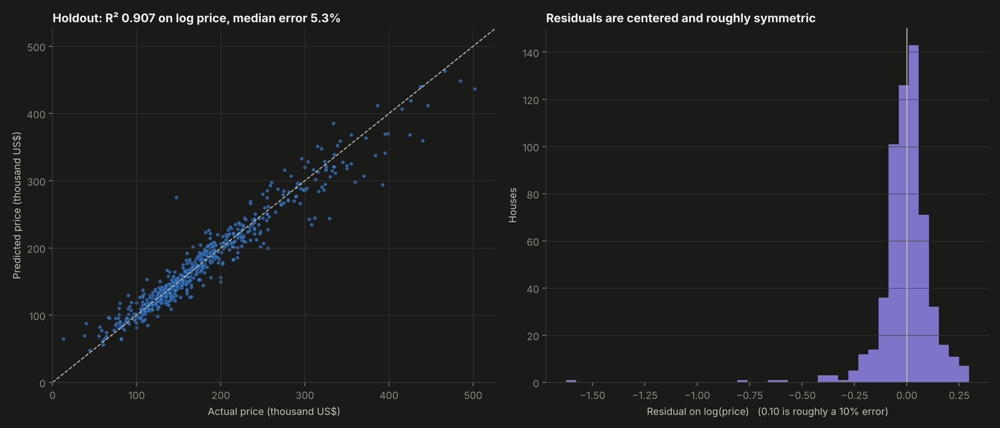
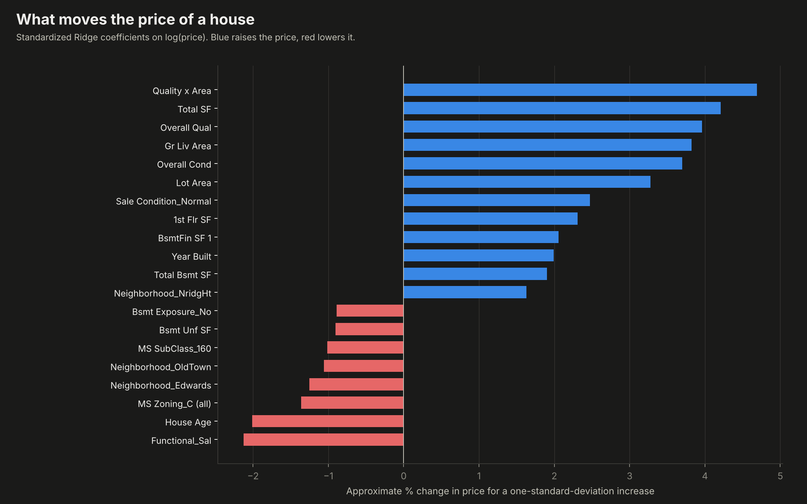

# 01. House Price Prediction


Predicting the sale price of 2,925 homes in Ames, Iowa with linear regression **implemented from scratch in NumPy** (normal equation, closed-form Ridge and gradient descent), on top of a full data-cleaning and feature-engineering pipeline, and benchmarked against scikit-learn on identical folds.

**Result:** a median error of **5.3%** and an R² of **0.907** on log price for unseen houses, with a mean absolute error of about **US$13,000**.



---

## Why this project

Real estate is one of the largest assets people and companies own, and pricing it well matters for buyers, lenders and developers alike. House price prediction is also the classic first regression problem, which makes it the right place to prove I understand linear models from the inside: not just calling `fit`, but deriving the solution, implementing it and checking that it matches the industry library.

## Objectives

1. Clean a real dataset with 80 variables and structural missing values.
2. Engineer features that capture how buyers actually value a house.
3. Implement OLS, Ridge and gradient descent from scratch and verify them against scikit-learn.
4. Select the regularization strength with cross-validation and evaluate on a holdout set.
5. Explain which characteristics move the price.

## Data

**Ames Housing dataset** (De Cock, 2011): 2,930 residential sales in Ames, Iowa between 2006 and 2010, with 80 variables on size, quality, location, age and condition. It is the original, extended version of the Kaggle *House Prices* competition data.

## Methodology

**1. Cleaning**
- Removed the 5 sales above 4,000 sq ft of living area, as recommended by the dataset author (partial sales that distort the fit).
- Missing values that mean "the house does not have it" (no basement, no garage, no pool) were filled with `None` or `0`, not with averages.
- Lot frontage (490 missing) was imputed with the median of the same neighborhood.
- Result: 2,925 sales, zero missing values.

**2. Feature engineering**
- Quality ratings (Poor to Excellent) converted to an ordinal 0-5 scale.
- New features: total square feet, total bathrooms, house age, years since remodel, total porch area, quality x area interaction, and flags for pool, garage and new construction.
- 31 skewed numeric variables log-transformed; nominal variables one-hot encoded.
- Target modeled as `log(price)`, so errors are relative (a 10% miss counts the same on a cheap or an expensive house).
- Final design matrix: **272 features**.

**3. Models implemented from scratch** (`src/models.py`)

| Model | Solution |
|---|---|
| OLS | Normal equation, `beta = (X'X)^-1 X'y` with a pseudo-inverse |
| Ridge | Closed form, `beta = (X'X + alpha I)^-1 X'y`, intercept not penalized |
| Ridge by gradient descent | Batch gradient descent on the penalized MSE |

Standardization is also implemented by hand and fitted inside each fold to avoid leakage.

**4. Validation.** 5-fold cross-validation with the same folds for every model, a 25-point grid search for the Ridge penalty, and a final 80/20 holdout.

## Results

| Model | CV RMSE on log(price) |
|---|---|
| Baseline: living area only | 0.279 |
| OLS, normal equation (scratch) | 0.139 |
| scikit-learn LinearRegression | 0.122 |
| **Ridge closed form, alpha = 237 (scratch)** | **0.114** |
| Ridge, gradient descent (scratch) | 0.114 |
| scikit-learn Ridge, alpha = 237 | 0.114 |
| scikit-learn Lasso | 0.114 |

- **The implementations are correct:** the scratch Ridge matches scikit-learn to the fourth decimal, and gradient descent converges to the closed-form coefficients with a maximum difference of 0.000006.
- **Regularization is what makes the model work.** With 272 correlated features, plain OLS is unstable (its error varies more than twice as much across folds); Ridge cuts the error by 18% and stabilizes it.
- **Feature engineering more than halves the error** compared with a model that only uses living area.
- **Holdout (20% of sales never seen in training):** R² 0.907 on log price, median absolute error 5.3%, mean absolute error US$12,967.
- **Price drivers:** the quality x area interaction, total square feet, overall quality and condition push the price up; age, commercial zoning, salvage-condition homes and the Edwards and Old Town neighborhoods pull it down.

| | |
|---|---|
|  |  |
|  |  |

**Interactive:** `dashboard.html` gathers everything, including the rotatable 3D surface (`outputs/01_price_surface_3d.html`) and the neighborhood ranking (`outputs/06_neighborhoods.html`).

## Structure

```
01-house-price-prediction/
├── main.py              # full pipeline: cleaning, features, models, charts, dashboard
├── src/
│   ├── features.py      # cleaning and feature engineering
│   └── models.py        # OLS, Ridge and gradient descent from scratch, CV utilities
├── data/ames_housing.csv
├── outputs/             # charts and metrics.json
└── dashboard.html       # interactive dashboard
```

## How to run

```bash
pip install -r ../requirements.txt
python main.py
```

## Development process and use of AI

I defined the problem, the cleaning rules, the features and the validation design, and I interpreted the results. I used AI as a working partner for the hardest parts: brainstorming feature ideas, working through the derivation of the Ridge closed form and its gradient, and speeding up the plotting code. Every number in this README comes from `outputs/metrics.json`, produced by the code in this folder.

## What this project means for my development

Implementing the estimators myself turned linear regression from a library call into something I can derive, debug and defend. The project also taught me that most of the predictive power comes from understanding the data (cleaning rules and features that reflect how buyers think) and from honest validation. Real estate valuation connects directly with my interest in construction and project finance.

## Next steps

- Apply the same pipeline to housing prices in Bogotá.
- Add gradient boosting and compare it with the linear model.
- Prediction intervals to express uncertainty in each estimate.

---

**Author:** Tomás Alarcón, Systems and Computing Engineering, Universidad de los Andes

**Data:** De Cock, D. (2011). Ames, Iowa: Alternative to the Boston Housing Data as an End of Semester Regression Project. *Journal of Statistics Education*, 19(3).
