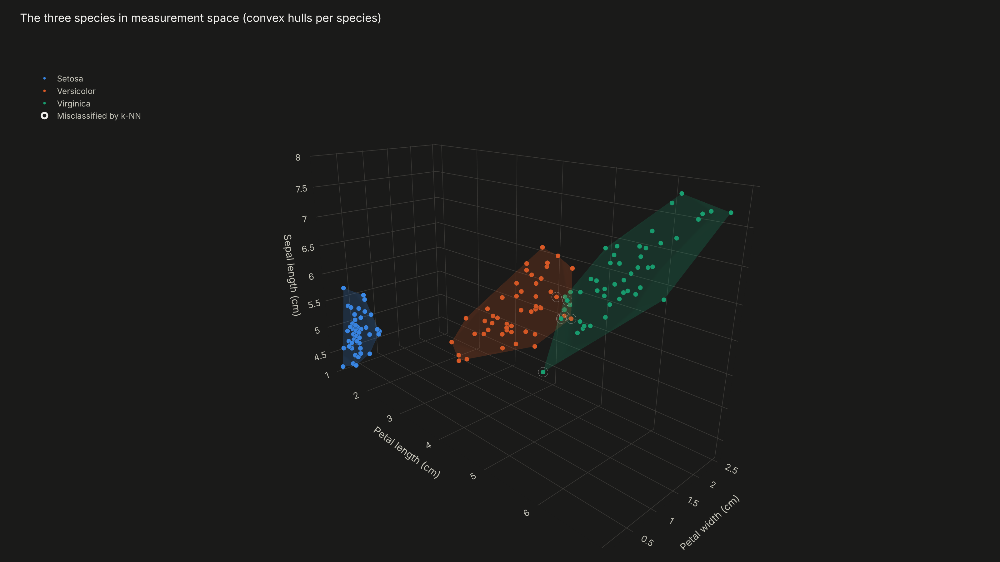
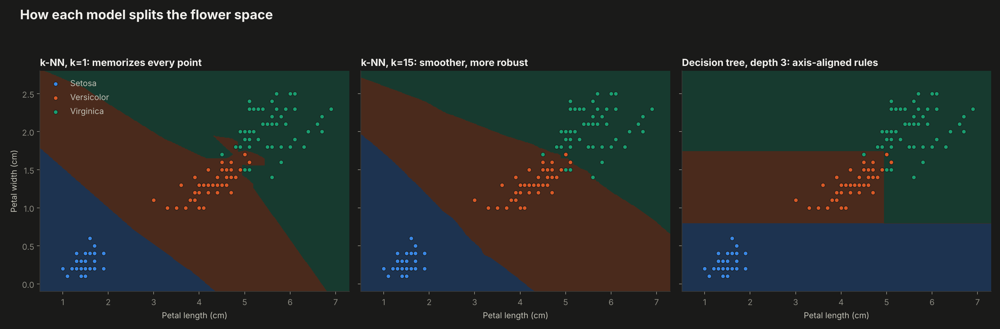
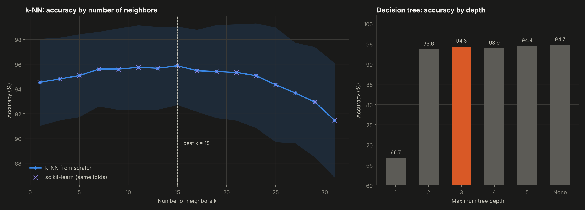
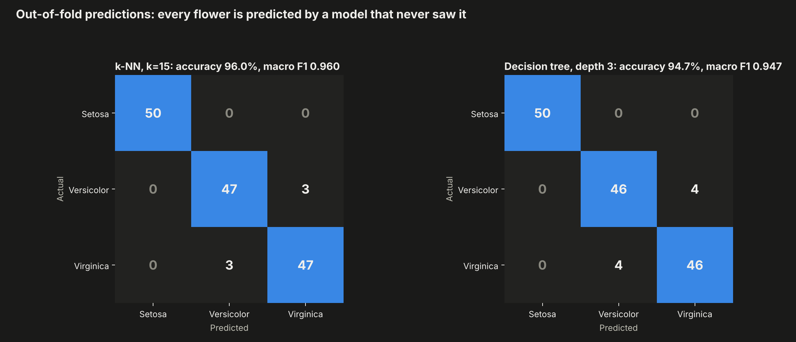
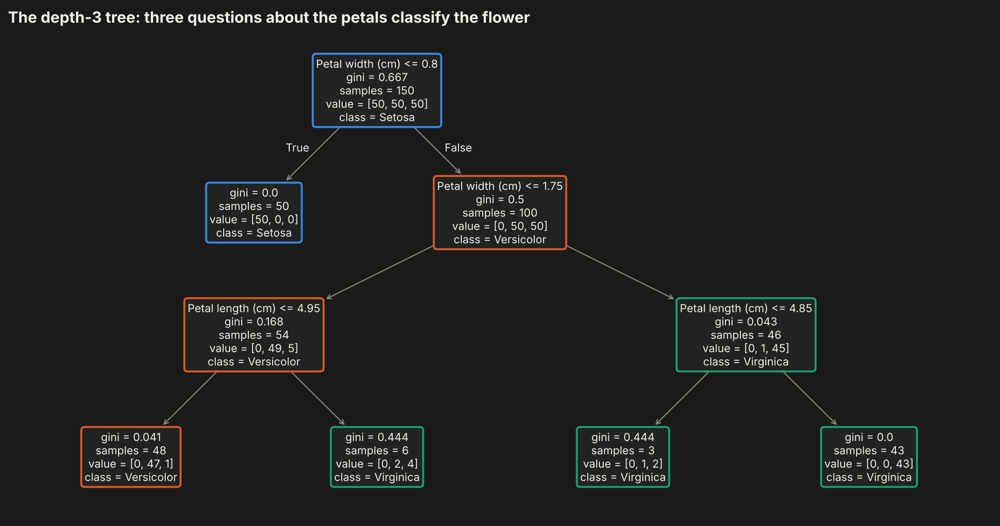

# 02. Iris Flower Classification


Classifying the three species of Iris flowers from four measurements with **k-nearest neighbors implemented from scratch in NumPy** and decision trees, evaluated with repeated stratified cross-validation that is also written by hand.

**Result:** 95.9% cross-validated accuracy with k-NN (k = 15), identical prediction for prediction to scikit-learn, and a three-question decision tree that reaches 94.3% using only petal measurements.



---

## Why this project

Iris is the classic first classification problem, so the value here is not the dataset but the rigor: implementing the algorithm, the metrics and the validation myself, comparing two model families that think in completely different ways (distance versus rules), and showing the trade-off between flexibility and generalization with evidence instead of intuition.

## Objectives

1. Implement k-NN, standardization, stratified k-fold, the confusion matrix and precision, recall and F1 from scratch.
2. Choose k and the tree depth with cross-validation, not by guessing.
3. Compare k-NN and decision trees against a baseline and against scikit-learn.
4. Make the behavior of each model visible: decision boundaries, the tree itself and the errors in 3D.

## Data

Fisher's Iris dataset (1936): 150 flowers, 50 per species (setosa, versicolor, virginica), with sepal length, sepal width, petal length and petal width in centimeters. Saved in `data/iris.csv`.

## Methodology

**From scratch** (`src/knn.py`):
- **k-NN:** Euclidean distance on standardized features, majority vote, ties broken by the smallest total distance.
- **Stratified k-fold:** every fold keeps one third of each species.
- **Repeated cross-validation:** 5 folds x 10 repetitions, so every score is the average of 50 test folds and its standard deviation is reported.
- **Metrics:** confusion matrix, accuracy, per-class precision, recall and F1, macro F1.

Standardization is fitted inside each training fold to avoid information leaking from the test fold.

**Models compared:** majority-class baseline, k-NN for k from 1 to 31, k-NN using only petals, decision trees of depth 1 to 5 and unlimited, and scikit-learn's k-NN on the same folds as a correctness check.

## Results

| Model | CV accuracy |
|---|---|
| Majority class baseline | 33.3% |
| k-NN, k = 1 (scratch) | 94.5% +/- 3.5 |
| **k-NN, k = 15 (scratch)** | **95.9% +/- 3.2** |
| scikit-learn k-NN, k = 15 | 95.9% +/- 3.2 |
| k-NN on petals only, k = 15 | 96.1% +/- 3.4 |
| Decision tree, depth 2 | 93.6% +/- 3.8 |
| Decision tree, depth 3 | 94.3% +/- 4.2 |
| Decision tree, unlimited depth | 94.7% +/- 3.7 |

- **The implementation is correct:** the scratch k-NN gives exactly the same predictions as scikit-learn (100% agreement) and the same score at every k.
- **More neighbors generalize better:** k = 1 memorizes every flower and draws jagged boundaries; k = 15 smooths them and gains 1.4 points.
- **Setosa is perfectly separable;** all errors are between versicolor and virginica, which overlap in a small region (3 errors in each direction for k-NN).
- **Petals carry the information:** the depth-3 tree uses only petal width (95% of the importance) and petal length, and dropping the sepals does not hurt k-NN.
- **Simplicity wins in the tree:** an unlimited tree is only 0.4 points better than depth 3 while being much harder to explain, so depth 3 is the model to show a non-technical audience.

| | |
|---|---|
|  |  |
|  |  |

**Interactive:** `dashboard.html`, with the rotatable 3D species clusters (`outputs/01_species_3d.html`) and the feature distributions (`outputs/06_feature_distributions.html`).

## Structure

```
02-iris-classification/
├── main.py              # model selection, evaluation, charts, dashboard
├── src/knn.py           # k-NN, scaler, stratified k-fold and metrics from scratch
├── data/iris.csv
├── outputs/             # charts and metrics.json (includes the tree rules)
└── dashboard.html
```

## How to run

```bash
pip install -r ../requirements.txt
python main.py
```

## Development process and use of AI

I defined the experiment design: which models to compare, the repeated stratified validation and the criteria to pick k and depth. I used AI as a working partner for the hardest parts: brainstorming the visual design of the boundaries and the 3D view, reviewing the tie-breaking logic of k-NN and accelerating the plotting code. All numbers come from `outputs/metrics.json`, produced by the code in this folder.

## What this project means for my development

Writing the metrics and the cross-validation by hand taught me what every number in a classification report actually means and how easily a careless split leaks information. Comparing a distance-based model with a rule-based one also gave me a practical sense of the accuracy versus explainability trade-off, which is central when a model has to be defended in front of a business or a credit committee.

## Next steps

- Build the decision tree itself from scratch (a later project in this series).
- Add probability calibration and ROC curves per class.

---

**Author:** Tomás Alarcón, Systems and Computing Engineering, Universidad de los Andes

**Data:** Fisher, R. A. (1936). The use of multiple measurements in taxonomic problems. *Annals of Eugenics*, 7(2).
