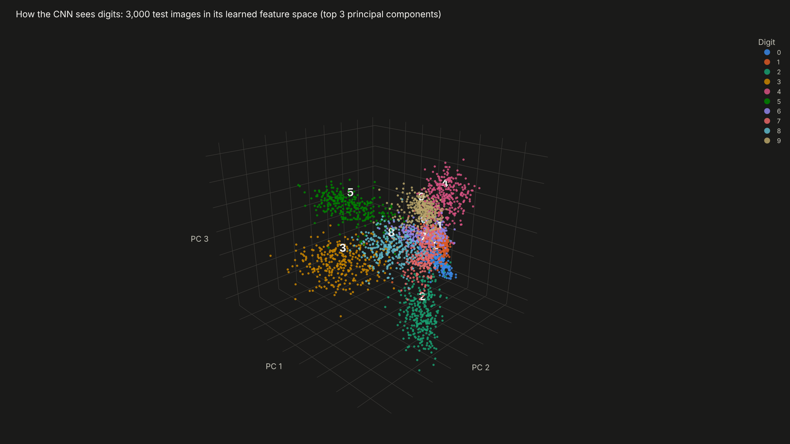
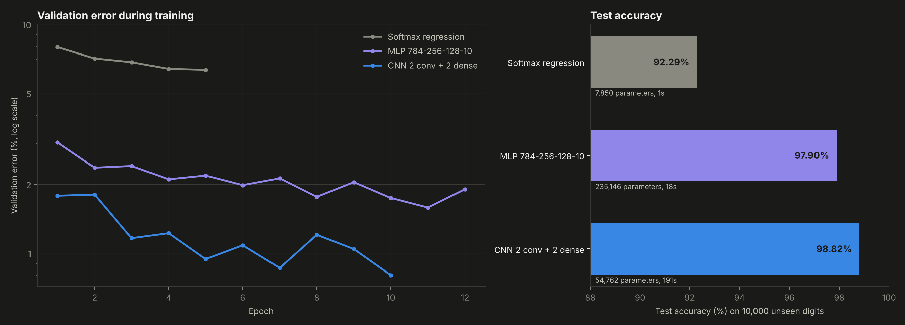
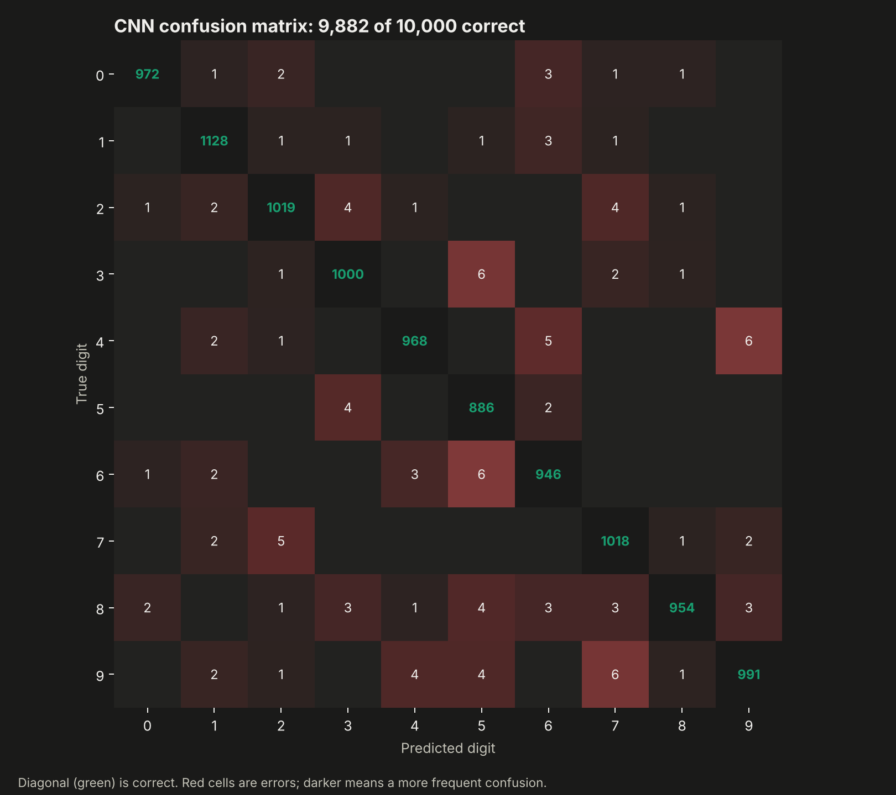
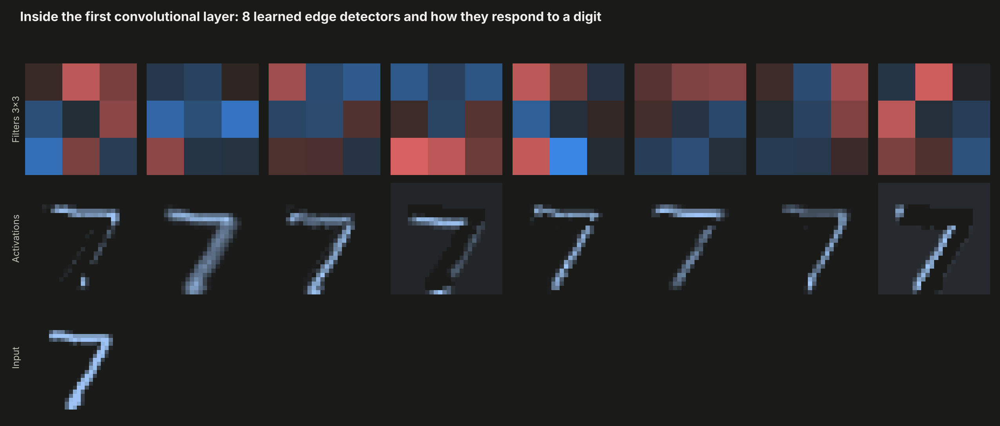
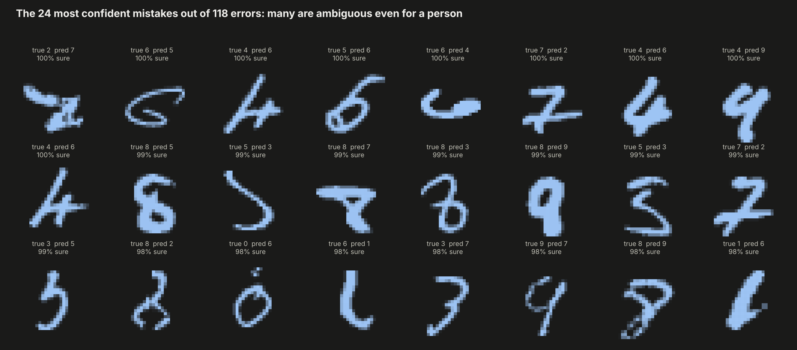

# 03. MNIST Handwritten Digit Recognition


Recognizing handwritten digits with a **small deep learning library written from scratch in NumPy**: dense and convolutional layers, max pooling, ReLU, dropout, softmax cross-entropy, backpropagation and the Adam optimizer. No PyTorch, no TensorFlow.

**Result:** the convolutional network reaches **98.82% accuracy on 10,000 test digits it never saw**, with only 54,762 parameters, and the backpropagation is verified against numerical gradients to a relative error of 3e-7.



---

## Why this project

Image recognition is where deep learning proved itself, and frameworks make it look like magic. Writing every forward and backward pass by hand, including the convolution, removes the magic: I can explain exactly how an image becomes a prediction and how the error flows back to every weight. That understanding transfers to any neural network I build later, including the ones I plan to use in finance.

## Objectives

1. Build the components of a neural network from scratch and prove the gradients are correct.
2. Train three architectures of increasing power on the same data and compare them.
3. Open the black box: visualize what the network learned and where it fails.

## Data

MNIST: 70,000 grayscale images of handwritten digits (28 x 28 pixels). 55,000 for training, 5,000 for validation during training and the official 10,000 for the final test. Stored compressed in `data/`.

## Methodology

**The library** (`src/nn.py`):

| Component | Implementation |
|---|---|
| Dense layer | `x @ W + b`, He initialization |
| Convolution | im2col with NumPy stride tricks, so the convolution becomes one matrix multiplication |
| Max pooling 2x2 | Gradient routed only to the first maximum of each window |
| ReLU, Dropout, Flatten | Element-wise masks |
| Loss | Numerically stable softmax with cross-entropy |
| Optimizer | Adam with bias correction |
| Verification | Centered finite-difference gradient check in float64 |

One bug found during the gradient check is worth noting: pooling windows on blank image regions contain ties, and sending the gradient to every tied value multiplies it. Routing it to a single maximum fixed it.

**Architectures**

| Model | Layers | Parameters |
|---|---|---|
| Softmax regression | 784 -> 10 | 7,850 |
| MLP | 784 -> 256 -> 128 -> 10, ReLU, dropout 0.2 | 235,146 |
| CNN | conv 8@3x3 -> pool -> conv 16@4x4 -> pool -> 128 -> 10, dropout 0.25 | 54,762 |

All three are trained with Adam (learning rate 0.001) and mini-batches.

## Results

| Model | Test accuracy | Test errors | Training time (CPU) |
|---|---|---|---|
| Softmax regression | 92.29% | 771 | 1 s |
| MLP | 97.90% | 210 | 18 s |
| **CNN** | **98.82%** | **118** | 191 s |

- **Convolutions win with fewer parameters:** the CNN has four times fewer parameters than the MLP and makes 44% fewer errors, because it exploits the spatial structure of the image instead of treating pixels as unrelated numbers.
- **Every digit is above 97.9% accuracy;** the hardest are 8 (97.95%) and 9 (98.22%).
- **The remaining confusions are human-like:** 9 read as 7, 6 as 5, 4 as 9 and 3 as 5, and many of the most confident mistakes are ambiguous even for a person.
- **The first layer learns edge detectors** (horizontal, vertical and diagonal strokes) on its own, and the 3D view of the last hidden layer shows the ten digits separated into clusters.

| | |
|---|---|
|  |  |
|  |  |

**Interactive:** `dashboard.html` and the rotatable 3D feature space in `outputs/01_feature_space_3d.html`.

## Structure

```
03-mnist-digit-recognition/
├── main.py           # gradient check, training of three models, charts, dashboard
├── src/nn.py         # the neural network library from scratch
├── data/             # MNIST in its original compressed format
├── outputs/          # charts and metrics.json (includes training histories)
└── dashboard.html
```

## How to run

```bash
pip install -r ../requirements.txt
python main.py
```

Takes about five minutes on a laptop CPU.

## Development process and use of AI

I chose the architectures, the training setup and the analysis, and I debugged the library with the gradient check. I used AI as a working partner for the hardest parts: deriving the backward pass of the convolution with im2col, diagnosing the pooling tie issue the gradient check exposed, and brainstorming the visualizations. All numbers come from `outputs/metrics.json`, produced by the code in this folder.

## What this project means for my development

This is the project where neural networks stopped being a black box for me. Writing the convolution backward pass and catching a real bug with a gradient check gave me the confidence to build and audit models instead of only calling them, which is what I want when applying deep learning to financial time series and documents.

## Next steps

- Data augmentation (small rotations and shifts) to push past 99%.
- Batch normalization and a deeper CNN.
- Port the same architecture to PyTorch and compare speed and accuracy.

---

**Author:** Tomás Alarcón, Systems and Computing Engineering, Universidad de los Andes

**Data:** LeCun, Y., Cortes, C. and Burges, C. J. C. The MNIST database of handwritten digits.
