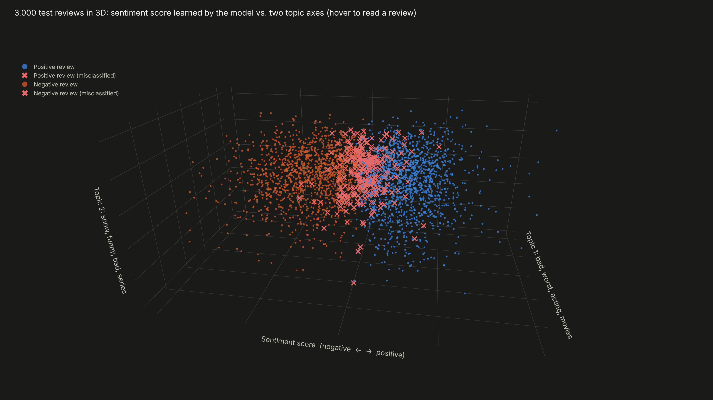
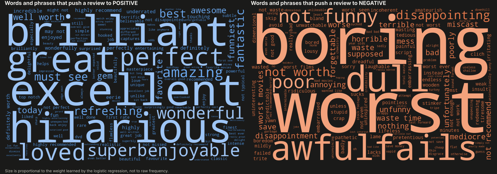
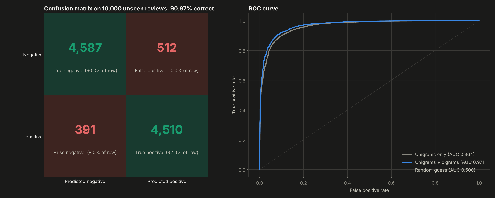
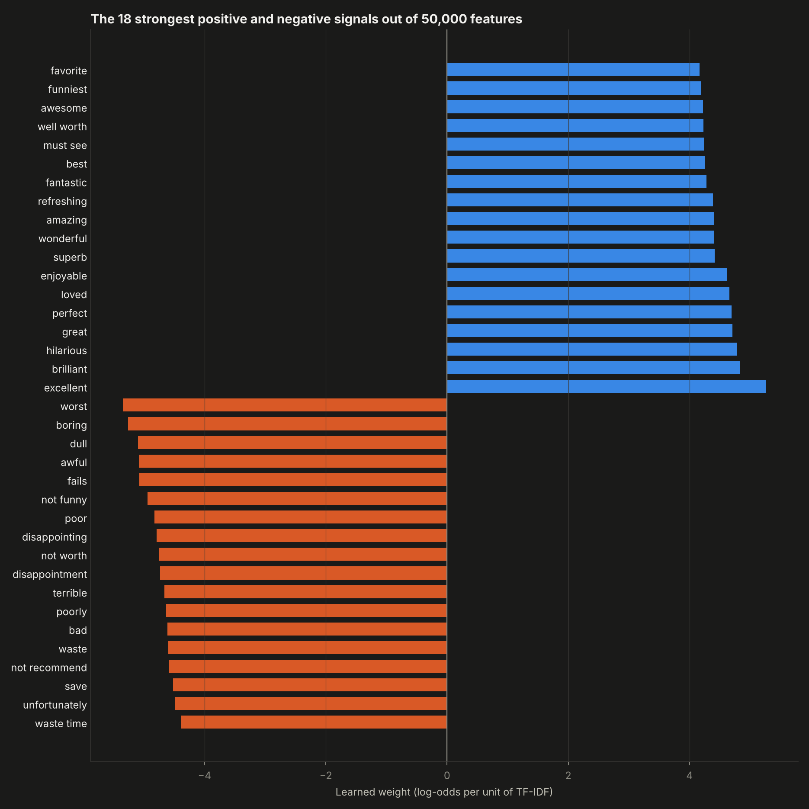
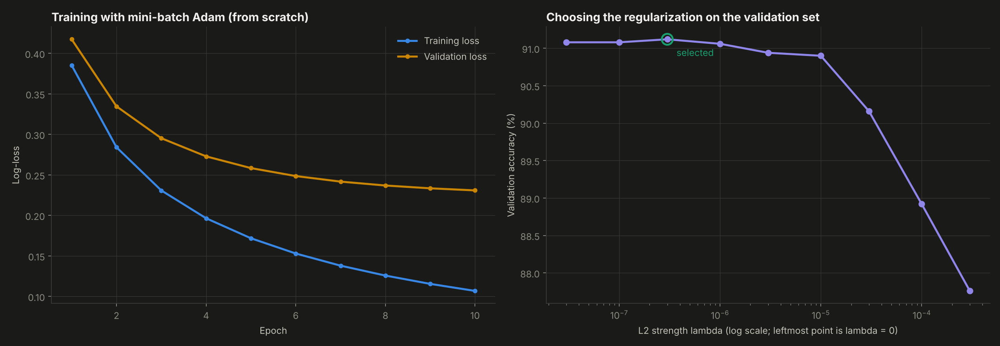
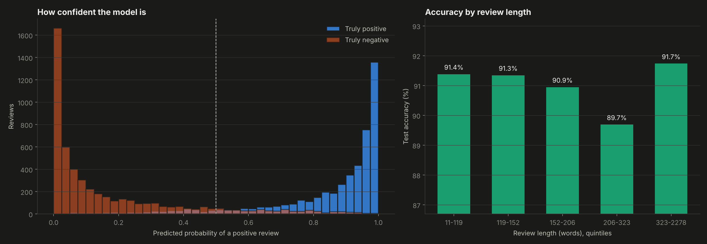

# 04. Sentiment Analysis on Movie Reviews


Predicting whether an IMDB movie review is positive or negative with a **text pipeline and logistic regression written from scratch**: cleaning, tokenization, TF-IDF with bigrams, L2-regularized logistic regression trained with Adam, and every evaluation metric.

**Result:** **90.97% accuracy and 0.971 ROC AUC on 10,000 reviews the model never saw**, slightly above scikit-learn with the same features (90.31%). The trained model also runs live in the dashboard: type any review and see the prediction and the weight of every word.



---

## Why this project

Most business data that matters is text: customer reviews, support tickets, analyst reports, news. Sentiment analysis is the entry point to all of it. Building the full pipeline by hand forces me to understand what the model actually reads, why a word like "not" changes everything and why a simple linear model is still a strong, explainable baseline before reaching for deep learning.

## Objectives

1. Turn raw HTML-laden reviews into numeric features with a preprocessing and TF-IDF implementation of my own.
2. Implement logistic regression, its gradient and its optimizer, and prove the gradient is correct.
3. Measure honestly: separate validation set for tuning, untouched test set, comparison against scikit-learn.
4. Explain the model: which words drive each decision and where it fails.

## Data

The IMDB Large Movie Review dataset (Maas et al., 2011): 50,000 reviews, perfectly balanced between positive and negative. **418 duplicated reviews were removed** before splitting, so no review can appear in both training and test. Split: 34,582 training, 5,000 validation, 10,000 test. Stored compressed in `data/`.

## Methodology

**Preprocessing** (`src/text.py`)
- HTML tags removed, lowercase, word tokenization.
- Contractions such as "didn't" and "wasn't" mapped to **"not"**, and negations are deliberately kept out of the stop word list, so the model can learn "not funny" and "not worth".
- Unigrams and bigrams, kept if they appear in at least 5 reviews and in less than 90% of them; the 50,000 most frequent are used.
- TF-IDF with sublinear term frequency, smoothed IDF and L2 normalization (the same definition as scikit-learn, which gives a 99% identical vocabulary).

**Model** (`src/logreg.py`)
- Logistic regression: mean log-loss plus L2 penalty, numerically stable sigmoid.
- Mini-batch Adam with bias correction, 10 epochs.
- Gradient check with centered finite differences: worst relative error **3.4e-7**.
- Accuracy, precision, recall, F1, log-loss and ROC AUC (Mann-Whitney formulation) implemented by hand.
- The L2 strength is chosen on the validation set from nine values between 0 and 3e-4.

## Results

| Model (test set, 10,000 reviews) | Accuracy | F1 | ROC AUC |
|---|---|---|---|
| Majority class baseline | 50.00% | - | 0.500 |
| Scratch logistic regression, unigrams | 89.83% | 0.898 | 0.964 |
| **Scratch logistic regression, unigrams + bigrams** | **90.97%** | **0.909** | **0.971** |
| scikit-learn TF-IDF + logistic regression (C tuned on validation) | 90.31% | 0.901 | 0.965 |

- **Bigrams add 1.1 points** by capturing phrases a single word cannot: "not funny", "not worth", "must see", "well worth", "waste time".
- **The implementation agrees with scikit-learn on 96.8% of the test reviews**, and the remaining difference comes from optimization (Adam with a fixed number of epochs acts as early stopping) rather than from the features.
- **Errors are balanced:** 10.0% of negative reviews are called positive and 8.0% of positive ones are called negative.
- **The strongest signals are intuitive:** "excellent", "brilliant", "hilarious", "perfect" on one side; "worst", "boring", "dull", "awful", "fails" on the other.
- **Review length barely matters** (89.7% to 91.7% across length quintiles).
- **The limits of a bag of words are visible in its mistakes:** a positive review praising a film as "so bad it's good", sarcasm, and long plot summaries full of dark vocabulary. The dashboard example "not bad at all, not great either" is scored as negative, because the model sees the words "bad" and "great" in a negated context it only partly understands.

| | |
|---|---|
|  |  |
|  |  |



**Interactive:** open `dashboard.html` to try the model on your own text, rotate the 3D review space and read the reviews behind each point.

## Structure

```
04-movie-review-sentiment/
├── main.py              # pipeline: split, TF-IDF, tuning, evaluation, charts, dashboard
├── src/text.py          # preprocessing, n-grams and TF-IDF from scratch
├── src/logreg.py        # logistic regression, Adam, gradient check and metrics from scratch
├── data/                # IMDB reviews (compressed CSV)
├── outputs/             # charts, metrics.json and model.js (weights for the live demo)
└── dashboard.html
```

## How to run

```bash
pip install -r ../requirements.txt
python main.py
```

Takes about three minutes on a laptop CPU.

## Development process and use of AI

I designed the experiment: the preprocessing decisions (keeping negations, adding bigrams, removing duplicates), the validation strategy and the comparison against scikit-learn. I used AI as a working partner for the hardest parts: reviewing the vectorized gradient and the tie handling in the AUC, brainstorming the 3D view and the live in-browser predictor, and accelerating the plotting code. All numbers come from `outputs/metrics.json`, produced by the code in this folder.

## What this project means for my development

This project gave me a complete, explainable NLP pipeline that I can reuse on business text, from customer reviews to financial news. It also taught me to respect strong baselines: a linear model that anyone can audit word by word reaches 91%, and that is the bar any more complex model has to beat to justify itself.

## Next steps

- Handle negation scope beyond the next word and test character n-grams.
- Compare against word embeddings and a small transformer fine-tuned on the same split.
- Apply the pipeline to Spanish-language product reviews and to financial news headlines.

---

**Author:** Tomás Alarcón, Systems and Computing Engineering, Universidad de los Andes

**Data:** Maas, A. L., Daly, R. E., Pham, P. T., Huang, D., Ng, A. Y. and Potts, C. (2011). Learning Word Vectors for Sentiment Analysis. *ACL 2011*.
