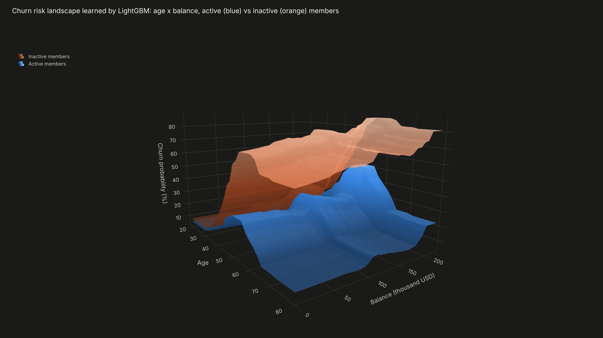
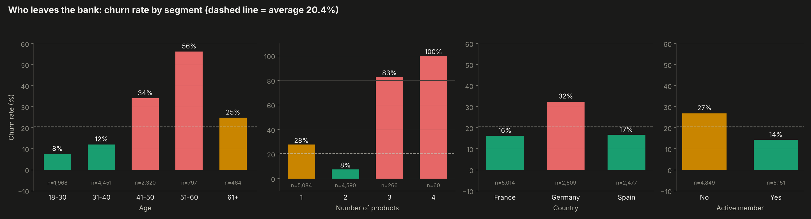
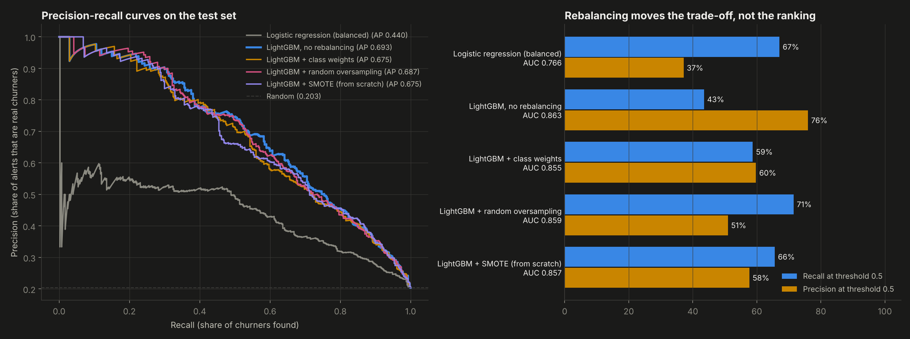
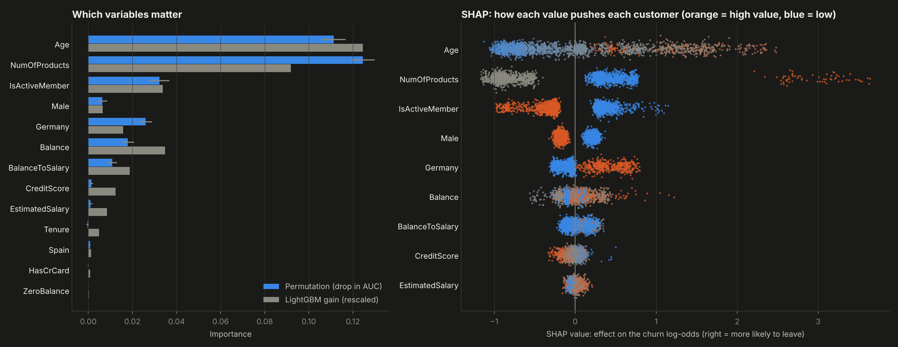
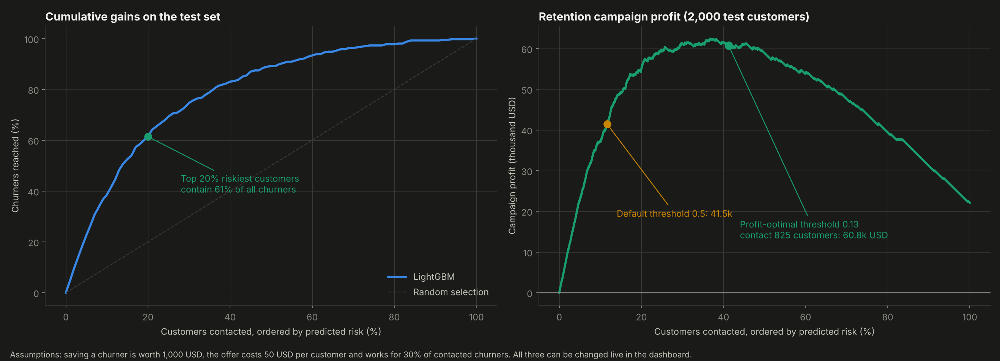
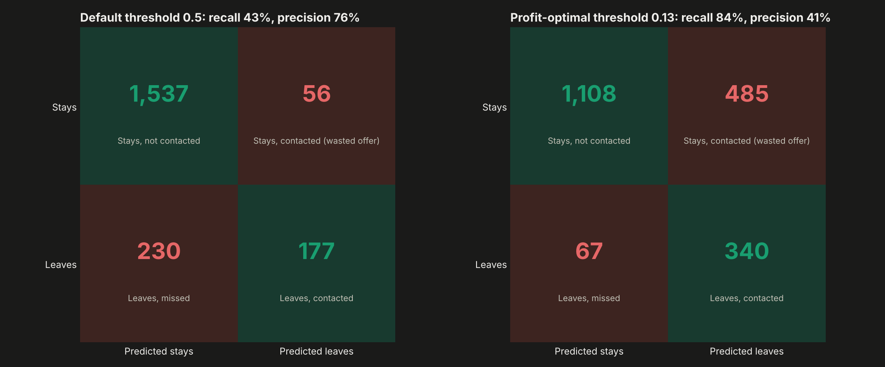

# 05. Customer Churn Prediction


Predicting which bank customers are about to leave, explaining why, and deciding **who should receive a retention offer**. LightGBM on 10,000 customers, four strategies for class imbalance compared (including **SMOTE written from scratch**), SHAP explanations, and an alert threshold chosen by **campaign profit** instead of the default 0.5.

**Result:** ROC AUC **0.863** on unseen customers. Contacting the riskiest 41% finds **84% of the churners** and earns an estimated **60,750 USD** on 2,000 test customers: **47% more than the default 0.5 threshold** (41,450 USD), almost three times more than contacting everyone (22,100 USD) and almost seven times more than contacting the same number of customers at random (9,116 USD).



---

## Why this project

Keeping a customer is cheaper than winning a new one. That makes churn one of the clearest places where a model turns into money, as long as it answers the questions a manager actually asks: who will leave, why, and how many of them it is worth calling. Accuracy alone does not answer any of them. This project goes from the data to that decision.

## Objectives

1. Predict churn with gradient boosting and compare it with a linear baseline.
2. Handle a 20/80 class imbalance and measure what each technique really changes.
3. Explain the model globally and for each customer.
4. Convert probabilities into a campaign plan with an explicit profit calculation.

## Data

Bank Customer Churn (Kaggle, 10,000 customers of a European bank in France, Germany and Spain): credit score, country, gender, age, tenure, balance, number of products, credit card, activity, estimated salary and whether the customer left (20.4%). Name and ID columns were removed. Two features were added: zero balance and balance-to-salary ratio. Stratified split written by hand: 6,000 training, 2,000 validation, 2,000 test, each with the same churn rate.

## Methodology

**From scratch** (`src/`)
- `imbalance.py`: stratified split, random oversampling and **SMOTE** (synthetic minority rows interpolated between a churner and one of its 5 nearest churner neighbors, with binary columns kept at 0 or 1). It turns 6,000 training rows into 9,556 balanced rows.
- `evaluation.py`: precision-recall curve, average precision, cumulative gains, the campaign profit curve and permutation importance.

**Models:** balanced logistic regression as baseline, and LightGBM (15 leaves, learning rate 0.03, early stopping on validation) trained four ways: no rebalancing, class weights, random oversampling and SMOTE.

**Decision rule.** The campaign assumptions are explicit and editable: saving a churner is worth 1,000 USD, the offer costs 50 USD per customer, and it convinces 30% of the churners who receive it. For every model, the threshold that maximizes profit is chosen on the **validation** set and then applied once to the test set.

**Explainability:** LightGBM gain importance, permutation importance (drop in test AUC when a column is shuffled) and SHAP values computed by LightGBM's native TreeSHAP.

## Results

| Model | Test ROC AUC | Average precision | Optimal threshold (validation) | Test profit | Mean predicted churn |
|---|---|---|---|---|---|
| Logistic regression, balanced | 0.766 | 0.440 | 0.42 | 48,150 USD | 43.1% |
| **LightGBM, no rebalancing** | **0.863** | **0.693** | **0.13** | **60,750 USD** | **19.6%** |
| LightGBM + class weights | 0.855 | 0.675 | 0.40 | 60,100 USD | 33.3% |
| LightGBM + random oversampling | 0.859 | 0.687 | 0.48 | 59,700 USD | 37.5% |
| LightGBM + SMOTE (scratch) | 0.857 | 0.676 | 0.45 | 59,150 USD | 35.0% |

Real churn rate: 20.4%.

- **Rebalancing moves the trade-off, not the ranking.** At the default 0.5 threshold SMOTE raises recall from 43% to 66%, which looks like a big win. But all LightGBM versions rank customers almost identically (AUC 0.855 to 0.863). Once the threshold is tuned for profit, they end up within 3% of each other.
- **Rebalancing distorts the probabilities.** Resampled models predict an average churn of 33% to 38% when the truth is 20%. The plain model predicts 19.6%, so its outputs can be read as real probabilities. Its profit-optimal threshold (0.13) lands close to the theoretical break-even probability of 50 / (0.30 x 1,000) = 0.167. Being able to trust the probabilities is why it was selected, and why the dashboard calculator can show them to a manager.
- **The threshold is the business decision.** Lowering it from 0.5 to 0.13 raises recall from 43% to 84%. Precision drops from 76% to 41%, but each missed churner costs far more than a wasted offer.
- **Who leaves:** customers aged 41 to 60 (34% to 56% churn), customers with 3 or 4 products (83% and 100%), customers in Germany (32%) and inactive members (27% versus 14%). Two products is the safest profile (8%).
- **The three explanation methods agree:** age and number of products dominate, followed by activity, Germany and balance. Tenure, credit card and salary carry almost no signal.
- **Targeting power:** the riskiest 20% of customers contain 61% of all churners.

| | |
|---|---|
|  |  |
|  |  |



**Interactive:** `dashboard.html` includes:
- a **churn risk calculator**, where the full LightGBM model (166 trees) runs in the browser and returns exactly the same probabilities as Python;
- a **campaign simulator**, where changing the value of a customer, the cost of the offer or its success rate redraws the profit curve and the best number of customers to contact;
- the rotatable 3D risk landscape.

## Structure

```
05-customer-churn-prediction/
├── main.py               # split, models, profit-based selection, explanations, charts, dashboard
├── src/imbalance.py      # stratified split, oversampling and SMOTE from scratch
├── src/evaluation.py     # PR curve, gains, profit curve, permutation importance from scratch
├── data/bank_churn.csv
├── outputs/              # charts, metrics.json and model.js (trees for the live calculator)
└── dashboard.html
```

## How to run

```bash
pip install -r ../requirements.txt
python main.py
```

Runs in under a minute.

## Development process and use of AI

I framed the problem as a business decision, chose the campaign assumptions, the validation design and the rule for selecting the model. I used AI as a working partner for the hardest parts: implementing SMOTE correctly with binary columns, exporting the LightGBM trees so the exact model runs in JavaScript, brainstorming the 3D risk landscape and the campaign simulator, and accelerating the plotting code. All numbers come from `outputs/metrics.json`, produced by the code in this folder.

## What this project means for my development

This is the project closest to how I want to work as a consultant: start from the decision, not from the algorithm. It taught me that a better metric on paper (recall after SMOTE) can hide worse probabilities, and that the most valuable parameter in a classification model is often the threshold, chosen with the client's own numbers.

## Next steps

- Uplift modeling: target customers whose behavior changes because of the offer, not only the ones at risk.
- Probability calibration (isotonic) and confidence intervals for the profit estimate.
- Survival analysis to predict when, and not only whether, a customer will leave.

---

**Author:** Tomás Alarcón, Systems and Computing Engineering, Universidad de los Andes

**Data:** Bank Customer Churn dataset (Kaggle). **SMOTE:** Chawla, N. V. et al. (2002). SMOTE: Synthetic Minority Over-sampling Technique. *JAIR*, 16.
