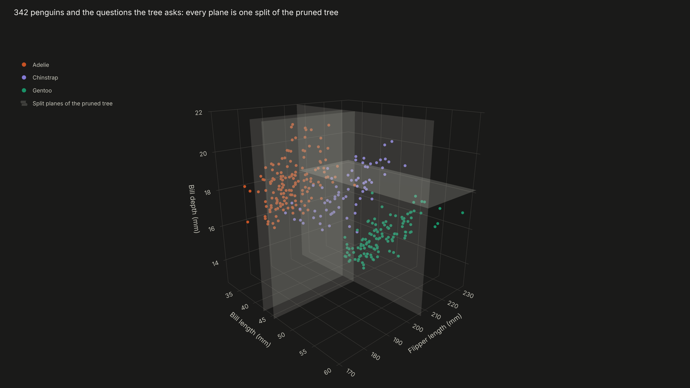
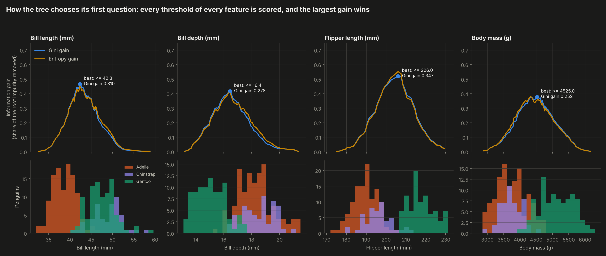
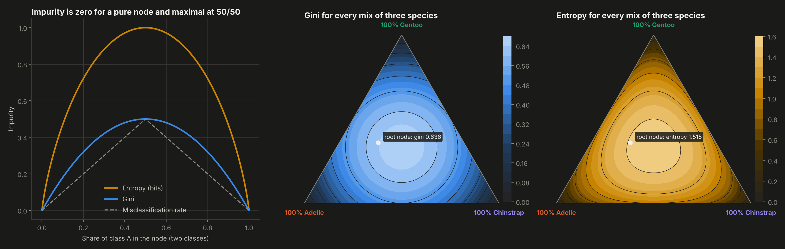
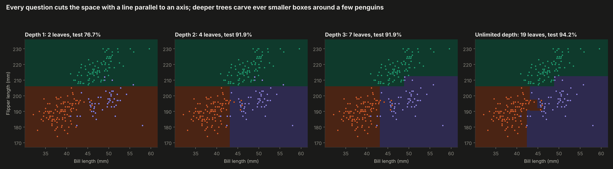
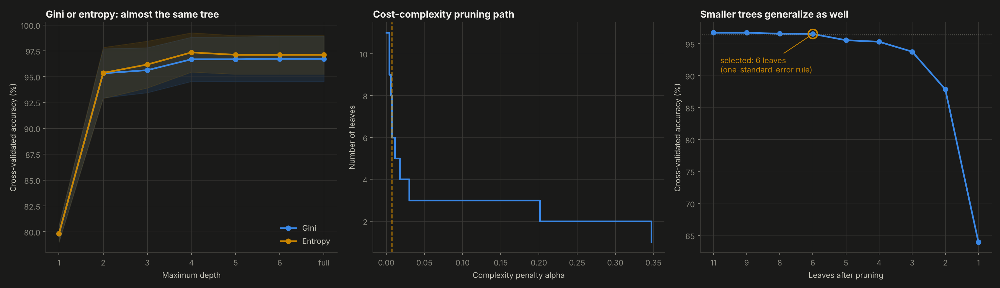
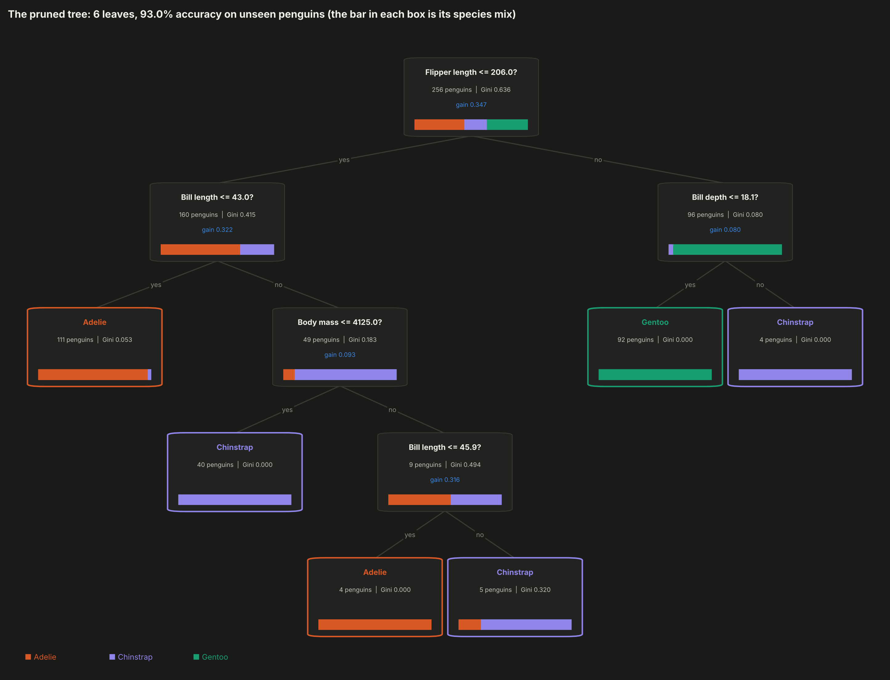
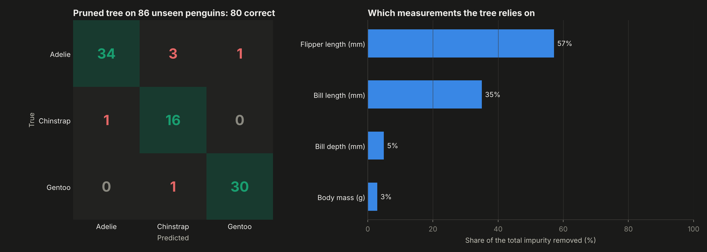

# 06. Decision Tree from Scratch


**How does a decision tree choose each question?** A CART classifier written from scratch in NumPy, with Gini and entropy impurity, information gain, an exhaustive split search, pre-pruning and cost-complexity post-pruning. It identifies three penguin species from four body measurements.

**Result:** the scratch tree matches scikit-learn exactly. Its predictions are 100% identical, it has the same depth, leaves and root split, and its pruning path agrees to 1e-16. After pruning, **a tree with only 6 leaves classifies 93.0% of unseen penguins correctly**, compared with 94.2% for the full 11-leaf tree. On a test set of 86 penguins, that difference is a single penguin.



---

## Why this project

Decision trees sit under the most used models in industry, such as random forests, XGBoost and LightGBM, and they are the most explainable model there is: a list of yes/no questions. Writing one from scratch answers precisely what the libraries hide. How are the candidate questions generated? What does "best" mean? Why stop growing? How do you cut back a tree that memorized the data?

## Objectives

1. Implement Gini impurity, entropy and information gain, and the search for the best question.
2. Grow, predict, explain (feature importance, decision path) and prune the tree.
3. Prove the implementation correct against scikit-learn.
4. Make every step visible: the gain of every possible question, the impurity functions, the tree itself and its cuts in 3D.

## Data

The Palmer Penguins dataset (Gorman, Williams and Fraser, 2014): 342 penguins of three species (Adelie 151, Chinstrap 68, Gentoo 123) from the Palmer Archipelago, Antarctica. Four measurements are used: bill length, bill depth, flipper length and body mass. The island is deliberately left out, because each species lives on specific islands and the tree would learn geography instead of anatomy. Stratified split: 256 training, 86 test.

## Methodology

**The algorithm** (`src/tree.py`)

| Piece | Implementation |
|---|---|
| Gini impurity | 1 - sum p_k^2: the chance that two random penguins in the node belong to different species |
| Entropy | -sum p_k log2 p_k: bits needed to encode the species of a random penguin in the node |
| Information gain | Parent impurity minus the size-weighted impurity of the two children |
| Split search | For each feature, sort once and accumulate class counts, so every threshold (the midpoint between consecutive distinct values) is scored in one vectorized pass, O(n log n) instead of O(n^2) |
| Stopping rules | Pure node, maximum depth, minimum samples to split, minimum leaf size, minimum gain |
| Post-pruning | Weakest-link cost-complexity pruning (Breiman et al., 1984): alpha(t) = (R(t) - R(T_t)) / (leaves - 1), collapsing the weakest node repeatedly |
| Explainability | Impurity-based feature importance and the decision path of any sample |
| Validation | Repeated stratified k-fold cross-validation |

**Model selection** is done with 10 x 5-fold cross-validation on the training set only. The pruning strength is chosen with the **one-standard-error rule**: the simplest tree whose accuracy is within one standard error of the best.

## Results

| Model | Leaves | Train accuracy | Test accuracy |
|---|---|---|---|
| One question (depth 1) | 2 | 80.1% | 76.7% |
| Depth 2 | 4 | 96.9% | 93.0% |
| Full tree, Gini | 11 | 100% | 94.2% |
| Full tree, entropy | 9 | 100% | 93.0% |
| **Pruned tree (alpha 0.0075)** | **6** | **98.4%** | **93.0%** |

- **The first question is "flipper length <= 206 mm?"** It beats the best question on bill length (gain 0.310), bill depth (0.278) and body mass (0.252) with a Gini gain of 0.347, because it separates almost all Gentoo penguins from the other two species at once. The second level then splits Adelie from Chinstrap by bill length (43 mm).
- **Gini and entropy produce almost the same tree:** the same first question and cross-validated accuracy within 0.7 points at every depth. The choice of impurity matters much less than the size of the tree.
- **Pruning removes 5 of 11 leaves at no meaningful cost.** Cross-validated accuracy goes from 96.7% to 96.5%, and the result is a tree a person can read in ten seconds.
- **Two measurements do most of the work:** flipper length (57% of the impurity removed) and bill length (35%).
- **The remaining errors are Adelie and Chinstrap penguins** with similar bills and flippers, which are the two species that overlap in every measurement.

| | |
|---|---|
|  |  |
|  |  |





**Interactive:** `dashboard.html` includes:
- **Be the tree:** pick a measurement, move the threshold and watch both groups, the Gini gain and the information gain update. One button jumps to the best threshold.
- **Follow a penguin:** set its measurements and the path through the tree lights up until it reaches a species.
- The rotatable 3D view, where each split of the tree is drawn as a plane inside the region where it applies.

## Structure

```
06-decision-tree-from-scratch/
├── main.py           # validation against scikit-learn, model selection, charts, dashboard
├── src/tree.py       # impurity, information gain, split search, tree, pruning and cross-validation
├── data/penguins.csv
├── outputs/          # charts, metrics.json and tree.js (tree and data for the dashboard)
└── dashboard.html
```

## How to run

```bash
pip install -r ../requirements.txt
python main.py
```

Runs in about 30 seconds.

## Development process and use of AI

I chose the dataset and the decision to leave the island out, designed the validation (cross-validation on training only, one-standard-error rule) and the checks against scikit-learn. I used AI as a working partner for the hardest parts: vectorizing the split search with cumulative counts, getting the weakest-link pruning to match scikit-learn's definition exactly, and brainstorming the interactive "be the tree" explorer and the 3D split planes. All numbers come from `outputs/metrics.json`, produced by the code in this folder.

## What this project means for my development

Trees are the base of the models I use most for business problems, from credit scoring to churn. Building one, and making it match the reference implementation down to the pruning path, means I can now explain any tree-based model to a non-technical audience. I can also defend why a smaller tree is often the better business choice.

## Next steps

- Regression trees (variance reduction) and missing-value handling.
- A random forest and gradient boosting built on top of this tree.
- Compare with the oblique splits that a single axis-parallel tree cannot make.

---

**Author:** Tomás Alarcón, Systems and Computing Engineering, Universidad de los Andes

**Data:** Gorman, K. B., Williams, T. D. and Fraser, W. R. (2014). Ecological sexual dimorphism and environmental variability within a community of Antarctic penguins (genus *Pygoscelis*). *PLoS ONE*, 9(3). Distributed by the palmerpenguins R package (Horst, Hill and Gorman).
**Method:** Breiman, L., Friedman, J., Olshen, R. and Stone, C. (1984). *Classification and Regression Trees*.
