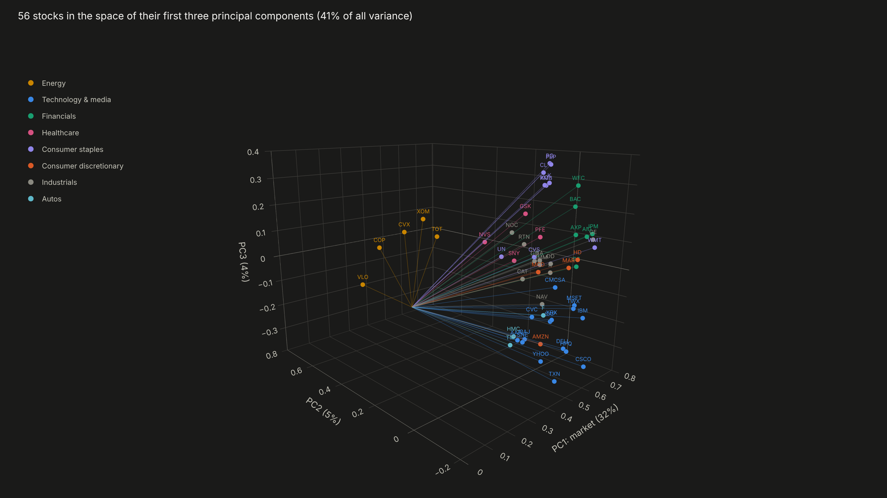
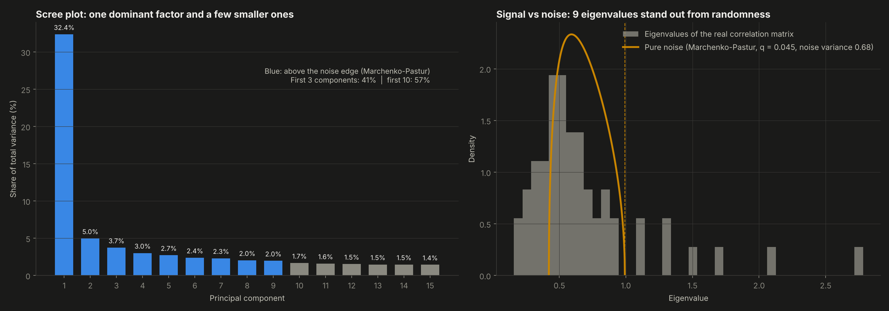
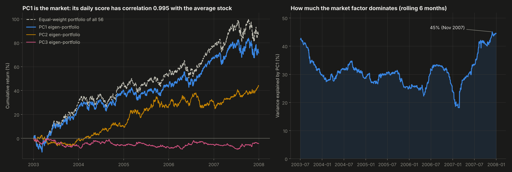
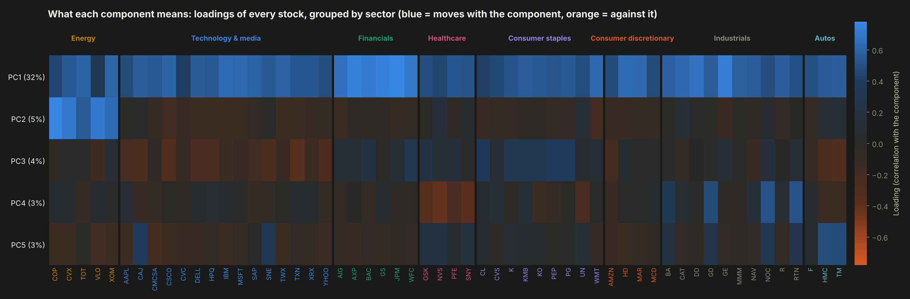
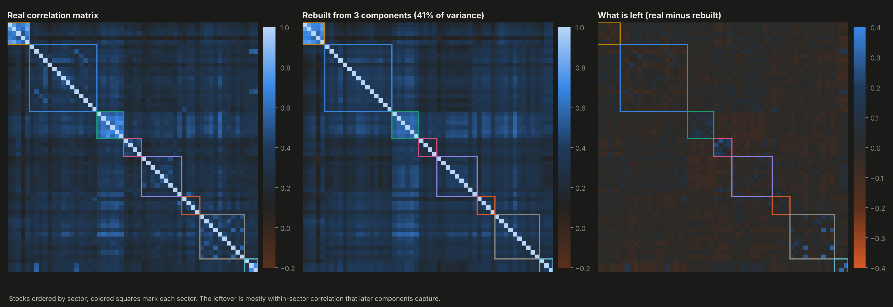
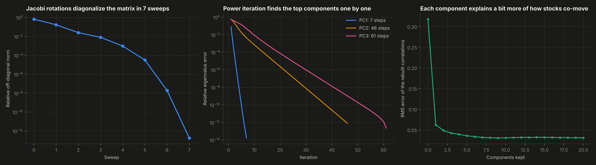

# 07. PCA from Scratch


**Principal component analysis built from the linear algebra up**: covariance matrix, eigen-decomposition with the Jacobi rotation method, power iteration with deflation, projection and reconstruction. It is applied to the daily returns of 56 large companies to find the few hidden factors that drive how stocks move together.

**Result:** one component, the market itself, explains **32.4%** of all the movement of 56 stocks, and its daily score has a **0.995** correlation with the average stock. The next components are recognizable economic forces:
- energy against technology;
- defensive consumer staples against growth;
- defense contractors against pharmaceuticals;
- Japanese companies.

Random-matrix theory says **9 components** carry real structure and the rest is noise. Every number matches NumPy and scikit-learn to within 1e-11 or better.



---

## Why this project

PCA is the standard tool to compress many correlated variables into a few meaningful ones. In finance it is everywhere: risk models, factor investing, yield curve analysis, hedging. It is also pure linear algebra: a covariance matrix and its eigenvectors. Implementing the eigen-solver myself, instead of calling it, turns "the first principal component" from a library output into something I can derive, compute and explain.

## Objectives

1. Compute the covariance (correlation) matrix, its eigenvalues and eigenvectors, and the projection by hand.
2. Implement two eigen-solvers, Jacobi rotations for the full spectrum and power iteration for the top components, and prove them correct.
3. Decide how many components are real signal, not by rule of thumb but against a null model of pure noise.
4. Interpret every component economically.

## Data

Daily open and close prices of 56 large U.S., European and Japanese companies from January 2003 to December 2007. This is the dataset scikit-learn uses in its stock market structure example. Eight sectors: technology and media (15), industrials (10), consumer staples (9), financials (6), energy (5), consumer discretionary (4), healthcare (4) and autos (3).

**Cleaning.** The prices are not adjusted for stock splits, so a 2-for-1 split looks like an overnight 50% crash. **20 splits** are detected automatically: an overnight gap within 3% of 1/2, 1/3, 2/3 or 1/4 is treated as a split, and earlier prices are rescaled. A few remaining extreme moves (a special dividend, a one-day data error) are handled by winsorizing each stock's daily log returns at the 0.1% and 99.9% quantiles. The result is 1,257 daily returns per stock.

## Methodology

| Step | Implementation (`src/pca.py`) |
|---|---|
| Standardize | Each stock to mean 0 and standard deviation 1, so a volatile stock does not dominate |
| Covariance | (X - mean)^T (X - mean) / (n - 1), which on standardized data is the correlation matrix |
| Eigen-decomposition | **Cyclic Jacobi method:** each rotation zeroes one off-diagonal pair, and repeated sweeps diagonalize the matrix. The accumulated rotations are the eigenvectors |
| Top components | **Power iteration with deflation:** repeatedly multiply a vector by the matrix until its direction stops changing, then remove that component and repeat |
| Projection and reconstruction | Scores = X V; X is rebuilt as scores V^T; correlations are rebuilt from the first k components |
| Signal vs noise | **Marchenko-Pastur law:** the eigenvalue spread expected from pure noise with N = 56 variables and T = 1,257 days. The noise level is what the market factor leaves (Laloux et al., 1999) |

**Verification:**
- correlation matrix vs `np.corrcoef`: 4e-15;
- Jacobi eigenvalues vs `np.linalg.eigh`: 1e-13;
- eigenvectors: 2e-11;
- explained variance vs scikit-learn: 2e-16;
- power iteration vs Jacobi: 2e-12;
- reconstruction with all components: 7e-14.

## Results

**How much each component explains:** PC1 32.4%, first 3 41.1%, first 5 46.8%, first 10 57.2%. Nine eigenvalues lie above the noise edge of 0.99, and everything below is indistinguishable from a random correlation matrix.

| Component | Variance | What it is | Stocks at the extremes |
|---|---|---|---|
| PC1 | 32.4% | **The market.** Every stock loads positively (0.32 to 0.78) | Most exposed: JPMorgan, Goldman Sachs, American Express, GE, Bank of America. Least exposed: Valero, Cablevision, Colgate, Novartis |
| PC2 | 5.0% | **Energy vs. technology** (oil price) | ConocoPhillips, Valero, Chevron, Exxon, Total against Cisco, Walmart, IBM, HP |
| PC3 | 3.7% | **Defensive vs. growth** | Procter & Gamble, PepsiCo, Colgate, Kellogg, Coca-Cola against Texas Instruments, Toyota, Cisco, Yahoo, Sony |
| PC4 | 3.0% | **Defense contractors vs. pharma** | Northrop Grumman, Raytheon, General Dynamics, Boeing against Novartis, Sanofi, GSK, Pfizer |
| PC5 | 2.7% | **Japan** | Honda, Toyota, Canon, Sony |

- **The market factor is a portfolio.** The PC1 eigen-portfolio tracks the equal-weight portfolio of all 56 stocks almost perfectly.
- **Diversification fades when it is most needed.** Over rolling six-month windows, PC1 explained between 18% and 45% of the variance. Its peak came in **November 2007**, as the credit crisis began and stocks started to move as one. This is the effect that makes correlations, and risk, jump in a crisis.
- **Three components already rebuild most of the correlation structure.** The average error per pair of stocks falls from 0.32 to 0.06 with one component and to 0.04 with three. What is left is mostly correlation inside sectors.
- **Both solvers converge to machine precision.** Jacobi needs 7 sweeps. Power iteration needs 7 steps for PC1 but 46 and 61 for PC2 and PC3, because their eigenvalues are close together.

| | |
|---|---|
|  |  |







**Interactive:** `dashboard.html` includes:
- a slider that rebuilds the full 56 x 56 correlation matrix from k components in real time;
- a selector to place every stock on any two components;
- the rotatable 3D view of the first three components.

## Structure

```
07-pca-from-scratch/
├── main.py                 # cleaning, PCA, verification, interpretation, charts, dashboard
├── src/pca.py              # covariance, Jacobi, power iteration, PCA class, Marchenko-Pastur
├── data/stock_prices.csv   # daily open and close, 56 stocks, 2003-2007
├── data/companies.csv      # name, sector and country of each ticker
├── outputs/                # charts, metrics.json and pca.js (data for the dashboard)
└── dashboard.html
```

## How to run

```bash
pip install -r ../requirements.txt
python main.py
```

Runs in about 20 seconds.

## Development process and use of AI

I chose to apply PCA to stock returns, designed the cleaning (split detection and winsorizing), the verification plan and the economic reading of each component. I used AI as a working partner for the hardest parts: the numerically stable form of the Jacobi rotation, the Marchenko-Pastur noise model, and brainstorming the interactive correlation rebuilder and the 3D view. All numbers come from `outputs/metrics.json`, produced by the code in this folder.

## What this project means for my development

This is where linear algebra stopped being abstract for me. An eigenvector became "the market", and an eigenvalue became "how much of the risk you cannot diversify away". The same tools, a covariance matrix, its eigen-decomposition and a test for noise, are the base of the risk and portfolio projects I plan next: stress testing, crisis correlations and CVaR optimization.

## Next steps

- Apply the same pipeline to Colombian stocks and to the TES yield curve (level, slope and curvature).
- Clean the correlation matrix by shrinking the noise eigenvalues and test whether it improves minimum-variance portfolios.
- Extend to 2008 to measure how the spectrum changes during the crisis.

---

**Author:** Tomás Alarcón, Systems and Computing Engineering, Universidad de los Andes

**Data:** daily prices from the scikit-learn examples data repository (`scikit-learn/examples-data`, financial-data).
**References:** Laloux, L., Cizeau, P., Bouchaud, J.-P. and Potters, M. (1999). Noise dressing of financial correlation matrices. *Physical Review Letters*, 83(7). Marchenko, V. A. and Pastur, L. A. (1967). Distribution of eigenvalues for some sets of random matrices.
