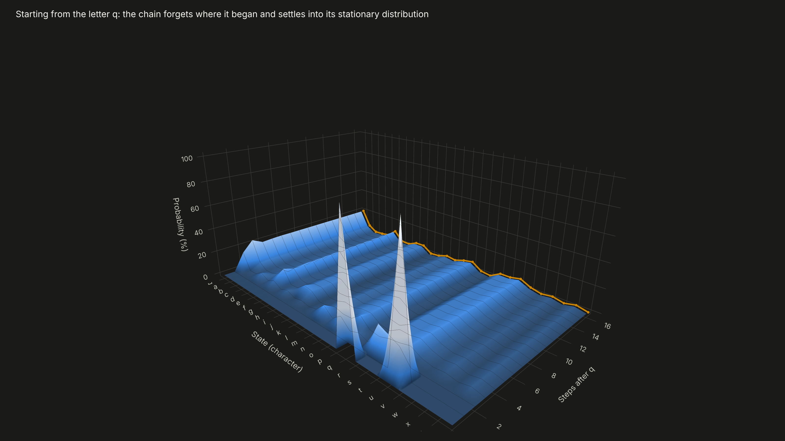
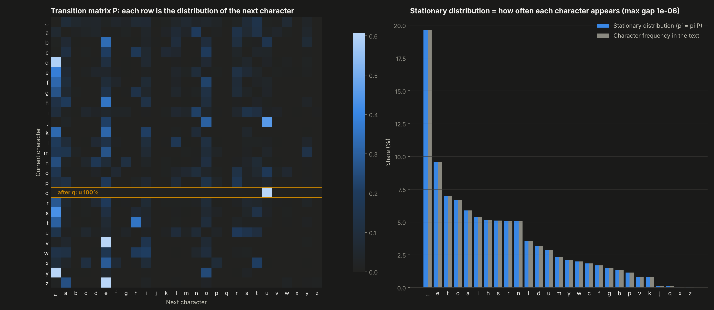
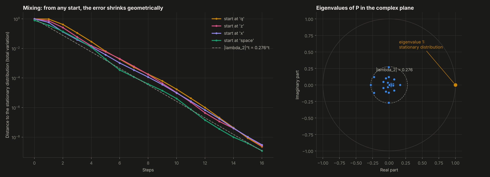
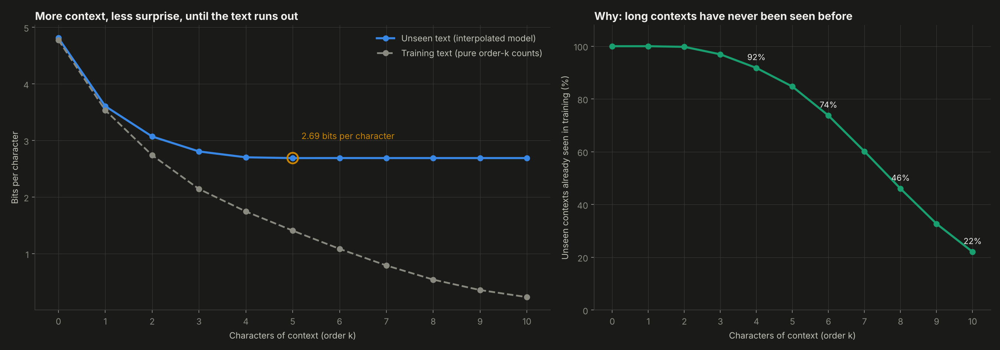
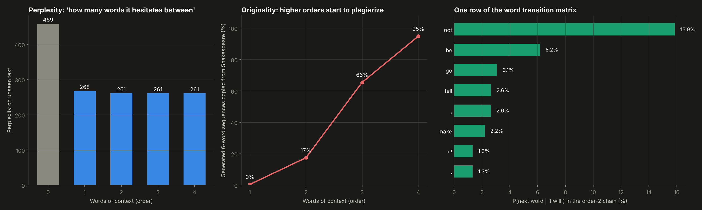

# 08. Markov Chain Text Generator


Generating Shakespeare one token at a time from **transition probabilities**, with the full theory of Markov chains written from scratch in NumPy. It covers the transition matrix, the stationary distribution (by power iteration and by eigenvector), how fast the chain forgets its starting point, and an interpolated language model whose weights are learned with the EM algorithm.

**Result:** the stationary distribution of the letter chain reproduces the letter frequencies of Shakespeare to within 1e-6. A model that reads 5 characters of context needs only **2.69 bits per character** on unseen text, compared with 4.81 without context. At the word level there is a clear trade-off: more context gives more fluent text, but an order-4 chain copies **95%** of its 6-word sequences straight from Shakespeare.



---

## Why this project

Markov chains are the simplest model of something that evolves step by step, and they are everywhere: credit rating migrations, customer journeys, PageRank, queueing, and the n-gram language models that came before today's LLMs. Building a text generator makes the math concrete. The transition matrix is "what comes next", the stationary distribution is "what happens in the long run", and the limits of n-grams explain why modern models need to generalize instead of memorize.

## Objectives

1. Build the transition matrix of a chain and compute its stationary distribution two ways.
2. Measure how quickly the chain mixes and link it to the eigenvalues of the matrix.
3. Generate text at the character and word level, with any order and temperature.
4. Evaluate honestly on unseen text, and measure the price of more context: data sparsity and copying.

## Data

*Tiny Shakespeare* (1.1 million characters, 40,000 lines of plays, public domain), as used in Andrej Karpathy's char-rnn. The text is split in contiguous blocks so no line leaks across sets: 85% training, 5% validation (to learn the interpolation weights), 10% test.

## Methodology

**From scratch** (`src/markov.py`)

| Piece | Implementation |
|---|---|
| Order-k chain | Counts of every next token after every k-token context; sampling with temperature |
| Transition matrix | Row-normalized count matrix P, where P[i, j] = P(next = j \| current = i) |
| Stationary distribution | Power iteration of pi = pi P from a uniform start, checked against the left eigenvector of P with eigenvalue 1 |
| Mixing | Total variation distance to pi after t steps, compared with the geometric rate \|lambda_2\|^t |
| Entropy rate | Uncertainty about the next state once the chain is in equilibrium |
| Language model | Jelinek-Mercer interpolation of orders 0 to K, with an add-one unigram so no token has probability zero. The weights are learned with **EM** on the validation text |
| Evaluation | Cross-entropy in bits per token and perplexity on the test text; the share of generated 6-word sequences copied verbatim from the training text |

**Three experiments:**
1. A 27-state chain over letters and space.
2. Character models with 0 to 10 characters of context.
3. Word models with 0 to 4 words of context.

## Results

**1. The letter chain**
- **Stationary distribution:** power iteration converges in 27 steps and matches the eigenvector to 1e-16. It also equals the actual letter frequencies of the text to within 1e-6, which is the theory working in practice.
- **Strongest rule:** after a q comes a u, 100% of the time.
- **Mixing:** the second eigenvalue has modulus **0.28**. Starting from a q, after 5 steps the distribution is already within 1% of equilibrium; the chain forgets where it began.
- **Entropy rate:** knowing the previous letter cuts the uncertainty about the next one from 4.09 bits (independent letters) to 3.32 bits.

**2. Context versus surprise (Shannon's experiment)**

| Characters of context | 0 | 1 | 2 | 3 | 4 | 5 | 10 |
|---|---|---|---|---|---|---|---|
| Bits per character, unseen text | 4.81 | 3.61 | 3.07 | 2.81 | 2.70 | **2.69** | 2.69 |
| Bits per character, training text | 4.78 | 3.54 | 2.74 | 2.14 | 1.75 | 1.41 | 0.23 |
| Unseen contexts seen in training | 100% | 100% | 100% | 97% | 92% | 85% | 22% |

- **On unseen text, gains stop after about 5 characters.** On the training text the model keeps "improving" towards zero bits, but that is memorization: 78% of the 10-character contexts in the test text never appeared in training.
- **EM learns where the information is.** It gives most of the weight to 3 to 5 characters of context and almost none beyond 7.

**3. Words: fluency versus originality**

| Words of context | 0 | 1 | 2 | 3 | 4 |
|---|---|---|---|---|---|
| Test perplexity | 459 | 268 | 261 | 261 | 261 |
| Generated 6-word sequences copied from Shakespeare | | 0.5% | 17% | 66% | **95%** |

- **Order 2 is the sweet spot.** Perplexity stops improving after it, while copying explodes. An order-4 chain no longer writes Shakespeare-like text; it recites Shakespeare.

**Samples** (more in `outputs/samples.txt` and live in the dashboard):

```
Characters, order 1:  Thor t m mes l m then, buchyoupave Ma k l se cosbofommyow.
Characters, order 5:  JULIET: Think to front, as I know not too much / To this beastly, sir.
Characters, order 8:  ROMEO: 'Tis not possible thing! more danger seen in the vault, / And look'd upon.
Words, order 2:       QUEEN MARGARET: Richard of York, / Writ in remembrance more than / He that depends
                      Upon so soft a subject, makes my number more. Pray you, go with us.
```

| | |
|---|---|
|  |  |
|  |  |

**Interactive:** `dashboard.html` includes:
- a **live generator** that builds the chain in your browser from the training text. You choose characters or words, the order, the temperature and the opening words.
- for each generated text, the **probabilities of the next token** after the current context, and the share of the text copied from Shakespeare;
- the 3D view of the distribution converging to equilibrium.

## Structure

```
08-markov-chain-text-generator/
├── main.py              # experiments, charts, samples, dashboard
├── src/markov.py        # chains, interpolated model with EM, transition matrix, stationary distribution, mixing
├── data/shakespeare.txt
├── outputs/             # charts, metrics.json, samples.txt and corpus.js (training text for the live generator)
└── dashboard.html
```

## How to run

```bash
pip install -r ../requirements.txt
python main.py
```

Takes about a minute.

## Development process and use of AI

I designed the three experiments, the contiguous train, validation and test split, and the originality metric. I chose to evaluate on unseen text instead of judging samples by eye. I used AI as a working partner for the hardest parts: the EM update for the interpolation weights, the link between the second eigenvalue and the mixing speed, and brainstorming the in-browser generator and the 3D convergence view. All numbers come from `outputs/metrics.json`, produced by the code in this folder.

## What this project means for my development

Markov chains are the language of anything that moves between states, from credit ratings and customer churn to market regimes. This project gave me the full toolkit (transition matrices, stationary distributions, mixing) on a problem where the results can be read. It also made the main limit of counting-based models visible: memorizing is not the same as understanding. That is the gap neural language models were built to close.

## Next steps

- Kneser-Ney smoothing and a comparison with a small character-level neural network on the same split.
- Apply the same tools to credit rating migration matrices and their long-run default probabilities.
- A Spanish corpus (Don Quijote) to compare the entropy of both languages.

---

**Author:** Tomás Alarcón, Systems and Computing Engineering, Universidad de los Andes

**Data:** Tiny Shakespeare, from Karpathy, A. *char-rnn* (2015). The works of William Shakespeare are in the public domain.
**References:** Shannon, C. E. (1951). Prediction and Entropy of Printed English. *Bell System Technical Journal*, 30(1). Jelinek, F. and Mercer, R. L. (1980). Interpolated estimation of Markov source parameters from sparse data.
