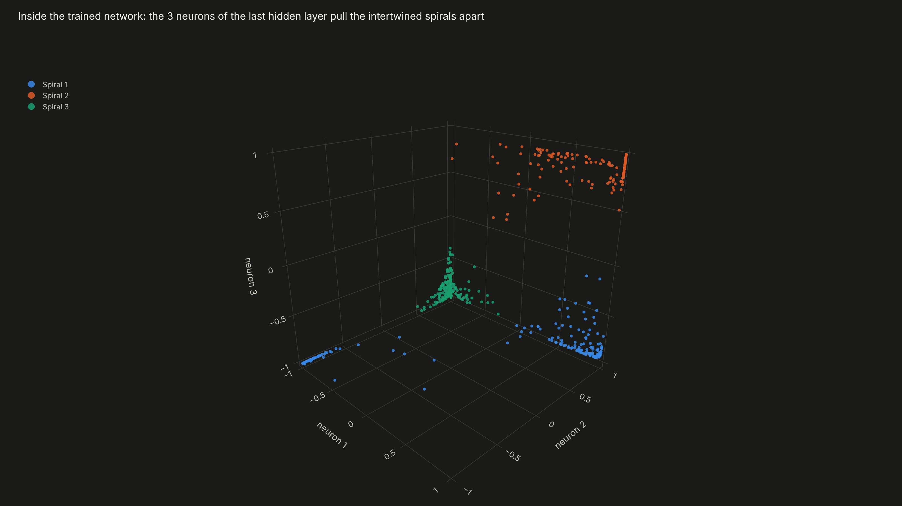
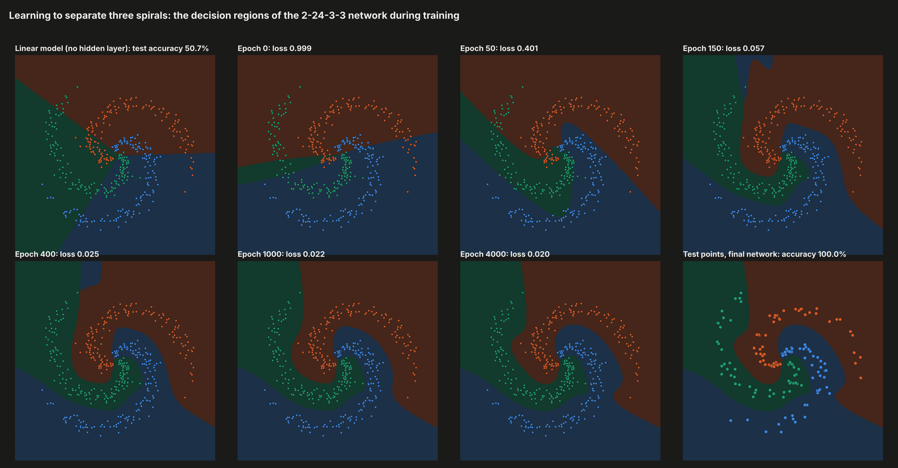
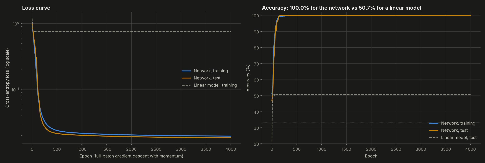
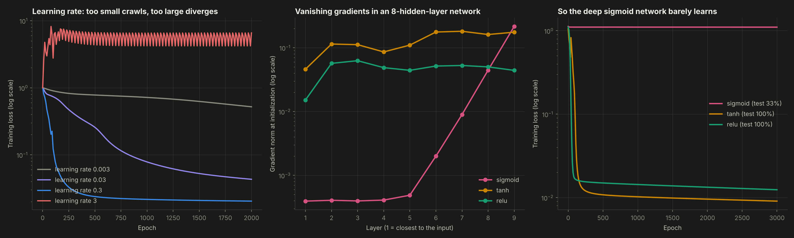
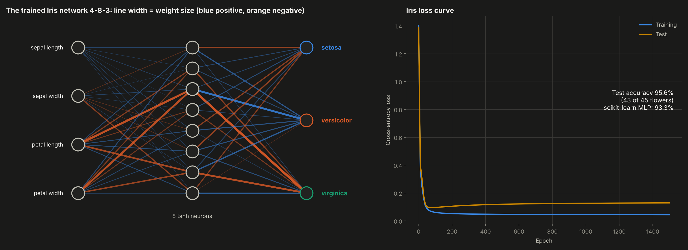

# 09. Neural Network from Scratch


**Forward pass and backpropagation without PyTorch.** A multilayer perceptron written in NumPy with every equation of the chain rule visible in the code (no layer objects, no autograd). It is trained by hand with gradient descent on three intertwined spirals and on the Iris flowers.

**Result:**
- **Spirals:** a straight line gets 50.7% of the test points right. A network with 159 parameters gets **100%**, and its 3-neuron hidden layer can be watched pulling the spirals apart in 3D.
- **Iris:** the same code classifies **95.6%** of unseen flowers, against 93.3% for scikit-learn's MLP.
- **Correctness:** backpropagation matches numerical gradients to **3e-8**.



---

## Why this project

Project 03 of this series built a modular deep learning library to reach 98.8% on MNIST. This one goes the other way: the smallest network that still shows every idea, written so each line of the backward pass maps to one equation. The goal is to be able to derive backpropagation on a whiteboard, explain why a network can draw curved boundaries that a linear model cannot, and diagnose the two classic ways training fails, a wrong learning rate and vanishing gradients.

## Objectives

1. Implement the forward pass, softmax cross-entropy and backpropagation explicitly, and verify the gradients.
2. Train with gradient descent and momentum and plot the loss curve.
3. Show what the hidden layer learns.
4. Run the experiments that explain training: learning rate, depth and activation function.

## Data

- **Three intertwined spirals:** 600 points in 2D, 200 per class, with noise. They are generated in `src/mlp.py` and saved to `data/spirals.csv`. No straight line can separate them, which makes the value of a hidden layer visible. Stratified split: 450 training, 150 test.
- **Iris:** 150 flowers, 4 measurements, 3 species. Stratified split: 105 training, 45 test, standardized with training statistics only.

## Methodology

**The equations** (`src/mlp.py`), for layer l:

```
Forward    Z_l = A_{l-1} W_l + b_l        A_l = g(Z_l)        P = softmax(Z_L)
Loss       L = mean cross-entropy(P, Y) + (lambda / 2) * sum ||W_l||^2
Backward   dZ_L = (P - Y) / n
           dW_l = A_{l-1}^T dZ_l + lambda W_l        db_l = column sums of dZ_l
           dA_{l-1} = dZ_l W_l^T                     dZ_{l-1} = dA_{l-1} * g'(Z_{l-1})
Update     v = 0.9 v - learning_rate * dW            W = W + v      (momentum)
```

- **Activations:** tanh, ReLU and sigmoid, each with its derivative.
- **Initialization:** Xavier for tanh and sigmoid, He for ReLU.
- **Gradient check:** centered finite differences on random weights and biases, for both a tanh and a ReLU network.
- **Main network:** 2 inputs, 24 tanh neurons, a **bottleneck of 3 tanh neurons** (so the learned representation can be drawn in 3D), and 3 softmax outputs. Trained for 4,000 full-batch epochs with learning rate 0.3, momentum 0.9 and L2 1e-4.

## Results

| Experiment | Result |
|---|---|
| Gradient check (tanh / ReLU) | 2.6e-8 / 6.0e-8 maximum relative error |
| Spirals, linear softmax model | 50.7% test accuracy |
| **Spirals, network 2-24-3-3** | **100% test accuracy**, final loss 0.020 (train) and 0.018 (test) |
| Iris, network 4-8-3 | **95.6%** test accuracy (43 of 45), scikit-learn MLP 93.3%, same prediction on 97.8% of the flowers |

- **The hidden layer untangles the data.** At initialization, the three neurons of the bottleneck mix the spirals. After training, each spiral sits in its own corner of the 3D cube, where a straight cut, which is all the output layer can make, separates them. This is what "learning a representation" means.
- **The boundary is learned in stages.** The loss falls from 1.0 to 0.40 in 50 epochs and to 0.06 by epoch 150, when the spiral arms appear. The rest of training refines the edges.
- **Learning rate:**
  - 0.003 is still at a loss of 0.52 after 2,000 epochs;
  - 0.03 reaches 0.043;
  - 0.3 reaches 0.020;
  - 3.0 never settles and oscillates between about 4 and 7.
- **Vanishing gradients:** in a network with 8 hidden layers of 16 sigmoid neurons, the gradient reaching the first layer at initialization is about 100 times smaller than near the output (4e-4 against 4e-2). The sigmoid network never leaves a loss of 1.10 and stays at 33% accuracy, which is chance. The same network with tanh or ReLU reaches 100%. This is why modern networks use ReLU-like activations and careful initialization.
- **Iris shows mild overfitting.** The test loss reaches its minimum around epoch 100 and then rises slightly while the training loss keeps falling. Early stopping would be the next step on a dataset this small.

| | |
|---|---|
|  |  |
|  |  |

**Interactive:** `dashboard.html` includes:
- a **live training playground**: the same equations rewritten in JavaScript train a 2-H-3 network on the spirals in the browser. You choose the number of hidden neurons, the activation and the learning rate, and watch the decision regions and the loss curve change epoch by epoch.
- the 3D hidden layer with a slider and a play button over training.

## Structure

```
09-neural-network-from-scratch/
├── main.py           # experiments, gradient checks, charts, dashboard
├── src/mlp.py        # forward pass, backpropagation, training loop, gradient check, spirals generator
├── data/             # spirals.csv and iris.csv
├── outputs/          # charts, metrics.json and spirals.js (data for the live playground)
└── dashboard.html
```

## How to run

```bash
pip install -r ../requirements.txt
python main.py
```

Runs in about 30 seconds.

## Development process and use of AI

I chose the bottleneck architecture so the hidden representation could be seen in 3D, designed the experiments on learning rate and depth, and decided to validate on a real dataset as well as a synthetic one. I used AI as a working partner for the hardest parts: writing the backward pass in compact matrix form, checking the derivatives of each activation, and brainstorming the browser playground and the animated 3D view. All numbers come from `outputs/metrics.json`, produced by the code in this folder.

## What this project means for my development

After this project I can open any neural network and say what each gradient is and where it comes from. I can also see training problems as numbers instead of mysteries: a diverging loss means a learning rate that is too high, and a flat loss in a deep network means gradients vanishing before they reach the first layers. That is the base for the deep learning I want to apply to finance, from time-series forecasting to the hedging agent in my roadmap.

## Next steps

- Mini-batch training, the Adam optimizer and early stopping, comparing their loss curves with full-batch gradient descent.
- Batch normalization and residual connections, to fix the deep sigmoid network.
- Use the same network as a regression model for financial time series.

---

**Author:** Tomás Alarcón, Systems and Computing Engineering, Universidad de los Andes

**Data:** synthetic spirals generated by the code. Iris: Fisher, R. A. (1936). The use of multiple measurements in taxonomic problems. *Annals of Eugenics*, 7(2).
**Reference:** Rumelhart, D. E., Hinton, G. E. and Williams, R. J. (1986). Learning representations by back-propagating errors. *Nature*, 323.
