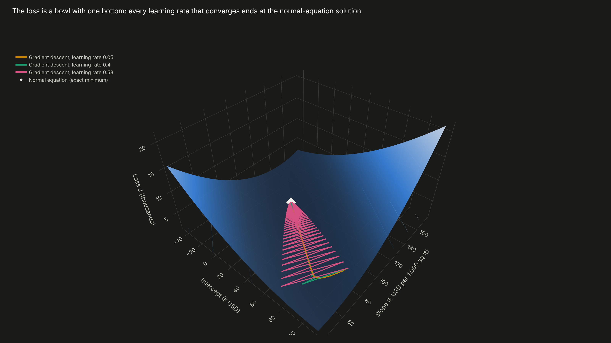
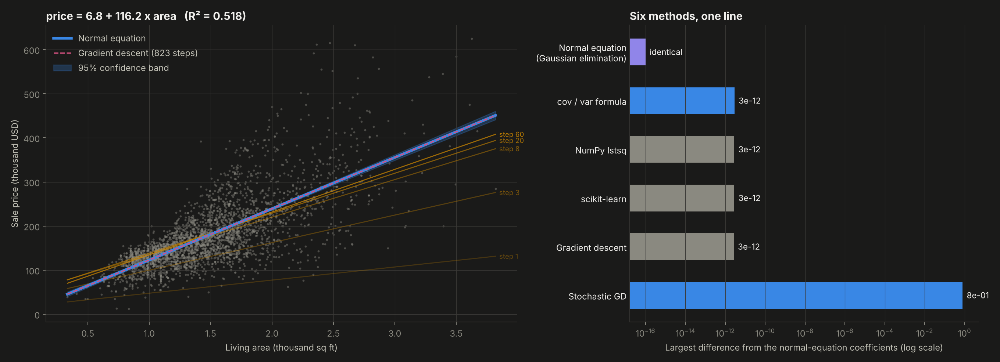
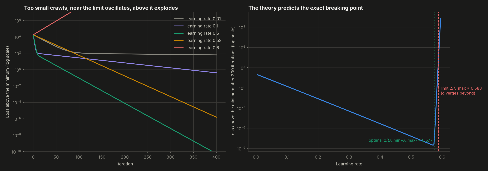
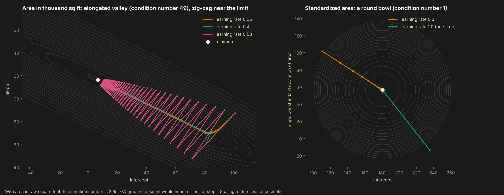
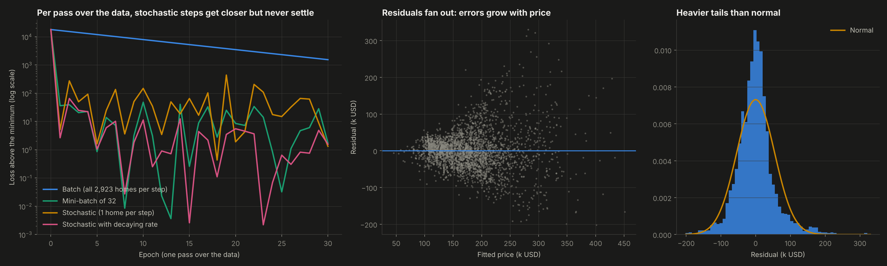

# 10. Linear Regression from Scratch


**Least squares two ways, from zero.** The normal equation is solved with Gaussian elimination written by hand. Gradient descent is run in batch, mini-batch and stochastic form. On 2,923 real home sales, **both reach the same line to 3e-12**. The project then shows exactly how the learning rate controls the trip: the theory predicts the precise value, **0.588**, where gradient descent stops converging and explodes, and the experiment confirms it.

**Result:** price = 6.8 + 116.2 x living area. Each extra 1,000 square feet adds about **116,000 USD** (95% confidence interval: 112,000 to 120,000), and area alone explains **52%** of the variation in price.



---

## Why this project

Linear regression is the first model in every course and the base of econometrics, factor models and pricing models in finance. It is also the one model where everything can be computed exactly: the loss is a perfect bowl, the minimum has a formula, and how fast gradient descent gets there can be predicted in advance. That makes it the best place to really understand gradient descent before trusting it on models where none of this can be seen, like the neural networks of projects 03 and 09.

## Objectives

1. Derive and implement the normal equation, including the linear solver.
2. Implement batch, mini-batch and stochastic gradient descent.
3. Show that both approaches reach the same line, against four independent references.
4. Measure the effect of the learning rate and explain it with the eigenvalues of the Hessian.
5. Show why feature scaling matters, and read the classical inference of the fitted line.

## Data

The Ames Housing dataset (De Cock, 2011), the same source as project 01 in this series: 2,930 home sales in Ames, Iowa, 2006 to 2010. Following the author's own recommendation, the 5 homes above 4,000 square feet (partial sales of unusual properties) are removed, leaving 2,923. The main model uses one predictor, living area, so the line, the loss surface and the descent path can all be drawn. A five-predictor model shows the same machinery in matrix form.

## Methodology

```
Model          y = X beta + e,  X = [1, living area]
Loss           J(beta) = (1 / 2n) ||X beta - y||^2
Gradient       grad J = X^T (X beta - y) / n
Hessian        H = X^T X / n          (constant, so J is an exact quadratic bowl)
Normal eq.     X^T X beta = X^T y     solved by Gaussian elimination with partial pivoting
Descent        beta <- beta - learning_rate * grad J
Stability      converges if and only if 0 < learning_rate < 2 / lambda_max(H)
Fastest rate   learning_rate = 2 / (lambda_min + lambda_max)
```

**Implemented from scratch** (`src/linreg.py`):
- Gaussian elimination and the normal equation.
- The one-variable cov/var formula.
- Batch, mini-batch and stochastic gradient descent, with an optional decaying learning rate.
- Standard errors, t statistics, p-values and confidence intervals.

## Results

**1. Six methods, one line**

| Method | Intercept | Slope | Difference from normal equation |
|---|---|---|---|
| Normal equation (Gaussian elimination, scratch) | 6.800 | 116.231 | reference |
| cov / var formula (scratch) | 6.800 | 116.231 | 3e-12 |
| Batch gradient descent (scratch, 823 steps) | 6.800 | 116.231 | 3e-12 |
| NumPy `lstsq` | 6.800 | 116.231 | 3e-12 |
| scikit-learn `LinearRegression` | 6.800 | 116.231 | 3e-12 |
| Stochastic gradient descent (scratch, 30 epochs) | | | 0.8 |

With five predictors (area, overall quality, year built, garage size, basement size), the normal equation, gradient descent and scikit-learn agree to 1e-11, and R² rises from 0.52 to **0.82**.

**2. The learning rate, predicted by the eigenvalues**

The Hessian has eigenvalues 0.070 and 3.399 (condition number 49). The theory therefore says gradient descent converges only below 2 / 3.399 = **0.588** and fastest at **0.577**.

| Learning rate | Behavior | Steps to converge (gradient below 1e-9) |
|---|---|---|
| 0.01 | crawls | 31,736 |
| 0.1 | slow | 3,165 |
| 0.3 | good | 1,049 |
| 0.577 (optimal) | fastest | **651** |
| 0.58 | zig-zags across the valley | 920 |
| 0.6 | **diverges**: the loss reaches 10^12 within 400 steps | never |

A scan of 200 learning rates shows the loss after 300 steps jumping from almost zero to infinity exactly at the predicted limit.

**3. Feature scaling is not cosmetic**
- **Area in raw square feet:** the condition number is **26 million**, and gradient descent would need millions of steps.
- **Area in thousands of square feet:** the condition number falls to 49.
- **Standardized area:** it is exactly 1. The bowl becomes perfectly round and gradient descent with learning rate 1 lands on the answer in a **single step** (the loop needs a second step to confirm it).

**4. Stochastic gradient descent**
- **Per pass over the data, steps on one home or on 32 homes get far closer** to the minimum than full-batch steps. The full-batch version is still about 1,500 above the minimum after 30 passes; the stochastic versions get to between 1 and 10.
- **They never settle:** they keep bouncing around the minimum, ending 0.8 away in the coefficients. A decaying learning rate reduces the noise.

**5. What the line says, and its limits**
- **Slope:** 116.2k USD per 1,000 sq ft (standard error 2.1, t = 56), clearly different from zero.
- **Residuals:** typical error of about **55k USD**. The errors grow with price (correlation between fitted price and squared residual 0.39). They also have heavier tails than a normal distribution (excess kurtosis 3.7).
- **Consequence:** the confidence intervals above assume constant variance, so robust standard errors or modeling the logarithm of price would be the honest next step. Project 01 does the latter.

| | |
|---|---|
|  |  |
|  |  |

**Interactive:** `dashboard.html` includes:
- **live gradient descent:** choose a learning rate and run or step through it. You see the path on the contour map of the loss next to the line it currently draws, and how far it is from the exact answer. Above 0.588 it diverges in front of you.
- the 3D loss surface with three learning rates descending the same bowl.

## Structure

```
10-linear-regression-from-scratch/
├── main.py              # experiments, verification, charts, dashboard
├── src/linreg.py        # Gaussian elimination, normal equation, gradient descent (batch, mini-batch, SGD), inference
├── data/ames_houses.csv # living area, price and four more features for 2,930 Ames home sales
├── outputs/             # charts, metrics.json and houses.js (data for the live demo)
└── dashboard.html
```

## How to run

```bash
pip install -r ../requirements.txt
python main.py
```

Runs in about 20 seconds.

## Development process and use of AI

I chose to keep a single predictor so every object could be drawn, designed the comparison against four references, and decided to test the theoretical learning-rate limit instead of only quoting it. I used AI as a working partner for the hardest parts: the link between the Hessian eigenvalues, the stability limit and the optimal step, the inference formulas, and brainstorming the live gradient descent demo and the 3D surface. All numbers come from `outputs/metrics.json`, produced by the code in this folder.

## What this project means for my development

This closes the ml-from-scratch series where machine learning starts: a line through points. It turns "tune the learning rate" from trial and error into a calculation. Behind the limit are the curvature of the loss and the scale of the features, and the same reasoning explains why the networks in projects 03 and 09 needed standardized inputs and careful steps. In finance, the same least squares sits under CAPM betas, factor models and every regression a credit or valuation analyst runs.

## Next steps

- Robust (heteroskedasticity-consistent) standard errors and a log-price model.
- Ridge and Lasso regularization paths, comparing them with project 01.
- Newton's method, which on this exact quadratic loss reaches the answer in one step from any start.

---

**Author:** Tomás Alarcón, Systems and Computing Engineering, Universidad de los Andes

**Data:** De Cock, D. (2011). Ames, Iowa: Alternative to the Boston Housing Data as an End of Semester Regression Project. *Journal of Statistics Education*, 19(3).
